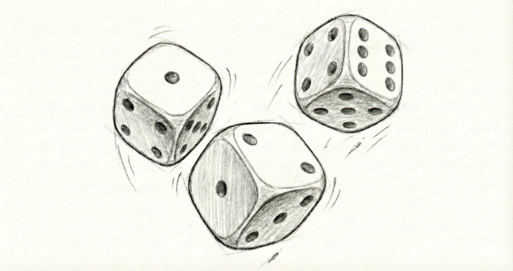

**Mini-d6 RPG v2.5**

por Bruno La Porta Welausen

# **Sistema** {#sistema}

## **O que é o Sistema mini-d6?** {#o-que-é-o-sistema-mini-d6?}

O **mini-d6** é um sistema de RPG de mesa minimalista ("regras leves"), projetado para priorizar a narrativa e a agilidade sem sacrificar a estrutura tática. Ele utiliza exclusivamente dados de seis faces (**d6**) para todas as resoluções, eliminando a necessidade de dados poliédricos complexos (d20, d12, etc.).

A filosofia central do sistema é que as regras devem servir como suporte leve para a história, permitindo que a criação de personagens e o início da aventura ocorram em poucos minutos.

## **Para quem é o Sistema?** {#para-quem-é-o-sistema?}

O sistema atende a três perfis principais de jogadores:

1. **Iniciantes e Grupos Casuais:** Pela sua simplicidade de regras e rapidez na criação de fichas, é ideal para quem nunca jogou RPG ou para grupos que têm pouco tempo e querem focar na diversão imediata.  
2. **Jogadores de "One-Shot" e Campanhas Curtas:** O sistema é otimizado para aventuras que começam e terminam em poucas sessões, embora suporte progressão até o nível 15\.  
3. **Jogadores Solo:** O documento v2.5 inclui regras específicas para descanso e eventos aleatórios pensadas para o "Modo Solo", permitindo jogar sem mestre.

## **Capacidades e Mecânicas Principais** {#capacidades-e-mecânicas-principais}

O sistema opera sobre um motor robusto de **3d6 \+ Atributo**, que gera uma curva de probabilidade (curva de sino) mais previsível e consistente do que o d20 linear.

* **Atributos Simplificados:** O personagem é definido por apenas três estatísticas: **Corpo** (Força/Constituição), **Mente** (Agilidade/Destreza/Carisma) e **Espírito** (Inteligência/Sabedoria/Magia).  
* **Resolução de Conflitos:** A mecânica padrão envolve rolar 3d6 e somar o atributo relevante para superar uma Dificuldade (Fácil 9, Comum 12, Difícil 15, Heroico 18\) ou a Defesa do oponente.  
* **Combate Tático e Equilibrado:** Graças aos ajustes recentes, o combate diferencia claramente duas etapas:  
  * **Evitar o Golpe (Defesa/Esquiva):** Onde o atacante rola contra a agilidade ou proteção mágica do alvo.  
  * **Mitigar o Dano (Resistência):** Onde armaduras reduzem diretamente o dano recebido, impedindo que personagens blindados sejam intocáveis, mas garantindo que sejam resistentes.  
* **Magia e Recursos:** Classes mágicas utilizam Pontos de Poder (**PP**) para conjurar feitiços que escalam em poder (d3s) e área, exigindo gestão de recursos.

## **Conteúdo e Escalabilidade** {#conteúdo-e-escalabilidade}

O **mini-d6** oferece um pacote completo para aventuras de fantasia medieval clássica:

* **Diversidade de Personagens:** Conta com 7 Raças (Humano, Anão, Elfo, Orc, Pequenino, Gnomo, Draconato) e 9 Classes (como Bárbaro, Paladino, Mago, Ladino, Bardo, etc.), cada uma com árvores de poderes passivos e ativos.  
* **Progressão:** O sistema cobre do Nível 1 ao 15, oferecendo aumentos de atributos, novos poderes e talentos (Níveis de Poder).  
* **Bestiário e Itens:** Inclui monstros desde Ratos Gigantes (Nível 1\) até ameaças lendárias como Lichs e Dragões (Nível 10+), além de itens lendários ("Dysenai") calibrados para o final do jogo.

## **Cenários de Uso Possíveis** {#cenários-de-uso-possíveis}

1. **Aventuras Heroicas Clássicas:** O sistema brilha em cenários de fantasia tradicional, exploração de masmorras e luta contra o mal, suportado pelas classes arquetípicas.  
2. **Campanhas de Alta Letalidade:** Como o **PV** (Pontos de Vida) é relativamente baixo e atrelado ao atributo Corpo \+ dados de classe, o combate é perigoso, incentivando tática e cautela.  
3. **Batalhas contra Chefes "Dark Souls":** Com o balanceamento matemático, é possível criar encontros contra chefes onde o acerto é difícil e a sobrevivência depende de equipamentos e buffs, sem que o jogo trave matematicamente.

Em resumo, o **mini-d6** é um sistema "plug-and-play" que oferece a profundidade tática de jogos maiores (como D\&D), mas com uma fração da complexidade matemática e tempo de preparação.

# **Rolagem de dados** {#rolagem-de-dados}

O sistema prevê uma abordagem simples, baseada em até 4 dados de 6 faces (d6) tornando o estilo acessível e dinâmico para todos, nesta seção será apresentada todas as formas de rolagem previstas nas regras.

No **mini-d6** as principais rolagens são baseadas em 3 dados d6, pela documentação chamaremos este modelo de **3d6**, em alguns casos pode haver a necessidade de um quarto dado, ele será validado para rolagens de vantagens ou desvantagens. Temos também rolagens de maior e menor que chamaremos de **Mm**, nestas rolagens são feitas apenas com 1 dado d6 (1d6).

### **1d6**

É a rolagem convencional de um dado de seis faces, ela geralmente é utilizada durante a ficha de personagens ou para algumas decisões de aleatoriedade dentro do jogo.

### **3d6**

Esta é a rolagem padrão utilizada na maioria das situações, como em combates, por exemplo, eventualmente pode acontecer de ser necessário rolar mais 1d6, geralmente em casos de validação por vantagens ou desvantagens.

* **Rolagens com vantagens:** nelas serão rolados 4 d6 e serão usados os 3 dados de **maior** valor.  
* **Rolagens com desvantagens:** nelas serão rolados 4 d6 e serão usados os 3 dados de **menor** valor.

### **Mm**

| Faces | Tipo | Valor |
| :---: | :---: | :---: |
| 1, 2 e 3 | menor | 1 |
| 4, 5 e 6 | maior | 2 |

A rolagem Mm considera a rolagem de 1d6 onde é validado os valores 6, 5 e 4 como maiores (M) e os valores 3, 2 e 1 como menores (m), é utilizada em algumas situações na criação de fichas de personagens e decisões dentro do jogo.

### **d3 (ou d-curto)**

| Faces | Valor |
| :---: | :---: |
| 1 e 2 | 1 |
| 3 e 4 | 2 |
| 5 e 6 | 3 |

A rolagem por d3, também chamado de d-curto (dado curto) divide o d6 em três partes iguais de valores conforme a tabela.

Ou seja, ao rolar 1d6 o valor dele vai ser ajustado dentro da regra dos terços do dado.

### **Críticos e Triplos**

No **mini-d6**, as rolagens de 3d6 possuem uma mecânica visual ágil para identificar momentos críticos e proezas:

* **Sucesso Crítico (dois dados 6):** Ocorre sempre que a rolagem contiver **ao menos dois dados com face 6** (ex: [6, 6, 2], [6, 6, 5]). É um acerto automático que ignora a Defesa do alvo, garantindo dano máximo em um dos dados ou uma vantagem tática na cena.
* **Crítico Caótico (Triplo 6 [6, 6, 6]):** O ápice heroico. Ignora armaduras e resistências, causa **dano máximo dobrado** e gera um impacto monumental na cena (empurra inimigos próximos, destrói coberturas ou quebra o escudo/arma do alvo).
* **Falha Crítica (dois dados 1):** Ocorre sempre que a rolagem contiver **ao menos dois dados com face 1** (ex: [1, 1, 3]). A ação falha automaticamente e gera uma complicação imediata (tropeçar, expor-se a Golpe de Oportunidade ou prender a arma).
* **Desastre Caótico (Triplo 1 [1, 1, 1]):** O revés catastrófico. A arma quebra ou voa longe, a corda do arco arrebenta, ou uma magia sofre refluxo causando 1d6 de dano no próprio conjurador.
* **Proezas Menores (Triplos Intermediários):** Rolagens com **[2, 2, 2]**, **[3, 3, 3]**, **[4, 4, 4]** ou **[5, 5, 5]** são sucessos especiais por sincronia: além do resultado normal, concedem um momento épico menor à escolha do jogador (recupera 1 PP, move-se 2m de graça sem provocar reações, ou ganha +1 de Defesa até o próximo turno).

# **Criação de personagem** {#criação-de-personagem}

Nesta seção definiremos as regras para a criação de ficha de personagem, cada um dos elementos que compõem a ficha, como funcionam as rolagens de dados

O personagem possui:

* Nome;  
* Raça;  
* Classe;  
* PV;  
* PP;  
* Exp;  
* Nível;  
* Atributos;  
* Dinheiro (PO);  
* Poderes;  
* Itens;  
* Mochila;

### **Nome**

É a forma como o personagem é chamado.

### **Raça**

Existe uma lista com as raças pré definidas, caso seja interessante é possível criar uma nova. A raça define algumas características do personagem como vantagens em atributos, por exemplo.

### **Classe**

Um conjunto de classes pré definidas ou criadas pela mesa, a classe define o que o personagem faz para ganhar a vida, como ele atua em certas situações.

### **PV**

**Pontos de Vida**, o **PV** do personagem é calculado com base no atributo **corpo** e a sua classe:
* Personagens que possuem classe cujo atributo **corpo** seja o principal (bárbaro, guerreiro e paladino) rolam **2d3 \+1** somados ao atributo Corpo.
* Personagens que possuem classe cujo atributo **espírito** seja o principal (mago, druida e clérigo) rolam **1d3 \+1** somados ao atributo Corpo.
* Personagens que possuem classe cujo atributo **mente** seja o principal (ladino, ranger e bardo) rolam **2d3** somados ao atributo Corpo.

O personagem perde **PV** ao sofrer algum tipo de dano. Quando o personagem tem seu **PV** igual a **0** ele desmaia e fica inconsciente. A cada turno o jogador pode rolar um **teste de constituição** (baseado em Corpo) com dificuldade Comum (12) com desvantagem para tentar estabilizar. O teste é uma melhor de 5 turnos:
* O personagem precisa obter **3 sucessos** para voltar à consciência com **1 PV** (ou **3 PV** em caso de sucesso crítico).
* Caso o personagem acumule **3 falhas**, ele morre.
* **Cura por Aliado:** Se um aliado curar o personagem caído com uma magia, poção ou item médico, ele estabiliza imediatamente, cancela os testes restantes e volta à consciência no início do seu próximo turno pronto para agir com os PVs concedidos pela cura.
* **Dano em Inconsciente:** Caso o personagem desmaiado (com **0 PV**) sofra qualquer dano adicional por meio de magia, efeito ou golpe, ele morre imediatamente. Caso o personagem tenha estabilizado e venha a tomar um golpe que zere seu PV novamente, ele volta ao estado de desmaio precisando de novos testes.

É possível recuperar o **PV** com um descanso curto ou longo, além de poções, comidas ou artefatos.

Resumo da distribuição de **PVs** iniciais:

* Atributo **corpo**: Corpo \+ 2d3 \+1  
* Atributo **mente**: Corpo \+ 2d3  
* Atributo **espírito**: Corpo \+ 1d3 \+1

### **PP**

**Pontos de Poder**, o **PP** do personagem é calculado com base no atributo **espírito** e a sua classe:
* Personagens que possuem classe cujo atributo **espírito** seja o principal (mago, druida e clérigo) rolam **2d3 \+1** somados ao atributo Espírito.
* Personagens que possuem classe cujo atributo **corpo** seja o principal (bárbaro, guerreiro e paladino) rolam **1d3 \+1** somados ao atributo Espírito.
* Personagens que possuem classe cujo atributo **mente** seja o principal (ladino, ranger e bardo) rolam **2d3** somados ao atributo Espírito.

O **PP** é usado para evocar poderes sendo consumidos a cada uso. O personagem não pode usar um poder que tenha um custo maior do que o seu limite atual de **PP**. Quando o **PP** chega a **0**, o personagem fica impossibilitado de usar poderes.

É possível recuperar o **PP** com um descanso curto ou longo, além de poções ou artefatos.

Resumo da distribuição de **PPs** iniciais:

* Atributo **corpo**: Espírito \+ 1d3 \+1  
* Atributo **mente**: Espírito \+ 2d3  
* Atributo **espírito**: Espírito \+ 2d3 \+1

### **Exp**

É a experiência do personagem, ele ganha em combate ou cumprindo missões. Personagens desmaiados ou inconscientes não ganham experiência.

### **Nível**

É o nível do personagem, ele passa de nível ao satisfazer certa quantidade de exp, por exemplo do nível 1 para o nível 2 é necessário 10 pontos de exp, ao atingir o total de de 10 pontos a exp fica zerada novamente iniciando uma nova contagem para o nível 3\.

### **Atributos**

O personagem possuí apenas 3 atributos, são eles:

* **corpo** \[força, constituição, resistência\]:  
* **mente** \[agilidade, destreza, carisma\]:  
* **espírito** \[inteligência, sabedoria, percepção\]:

Todos os atributos começam com 5 pontos, o jogador faz uma rolagem Mm para cada atributo e adiciona \+1 se cair menor e \+2 se cair maior. Cada classe possui 2 pontos de bônus e 2 pontos de penalidades distribuídos entre os atributos.

| Atributo | Base | Dado | Raça | Classe |
| :---: | :---: | :---: | :---: | :---: |
| Corpo | 5 | \+1 ou \+2 | 0 ou \+1 | entre \+2 e \-2 |
| Mente | 5 | \+1 ou \+2 | 0 ou \+1 | entre \+2 e \-2 |
| Espírito | 5 | \+1 ou \+2 | 0 ou \+1 | entre \+2 e \-2 |

Nenhum atributo na **criação de personagem (Nível 1)** pode ultrapassar 10 ou ser menor que 4, mesmo somando o resultado dos dados, o bônus racial e o modificador de classe. O teto de 10 representa o ápice do potencial inicial de um aventureiro (por exemplo, um Gnomo Mago com base 5 + dado 2 + classe 2 + raça 1 atinge exatamente 10 em Espírito). Valores superiores a 10 só podem ser alcançados posteriormente através da **progressão de níveis**, itens mágicos lendários ou efeitos especiais.

### **Dinheiro (PO)**

O dinheiro usado é chamado de PO, ou Peças de Ouro, por padrão, todo personagem começa com 50 POs para gastar com equipamentos e suprimentos. O dinheiro pode ser adquirido como recompensa ao cumprir missões, matando criaturas, através do comércio ou de outras formas de acordo com a aventura.

### **Poderes**

São as habilidades mágicas de cada personagem, é necessário consultar a listagem das classes para saber os poderes de cada uma em seus respectivos níveis.

### **Itens**

Todos os itens que o jogador carrega preparado, como armadura, arma, escudo...

Não é possível ter mais do que um item do mesmo tipo, por exemplo duas armaduras equipadas ou dois escudos, exceto armas de uma mão como espadas, adagas e afins. Itens de duas mãos estão limitados a apenas 1, pois não é possível empunhar duas espadas de duas mãos, por exemplo.

### **Mochila**

Todos os demais itens que não estão em uso. Não existe uma regra para definir a capacidade do jogador para carregar peso, isso fica a cargo da mesa ou do mestre em decidir caso queira ir para um sistema mais realista ou menos realista.

# **Raças** {#raças}

## **Humano** {#humano}

Adaptáveis, ideais para cobrir o prejuízo de \-1 da classe.

Traço racial: Versatilidade

Impacto Mecânico: \+1 em um Atributo à escolha (não pode ser o mesmo bônus da classe).

## **Anão** {#anão}

Aumenta automaticamente o PV inicial e a **Defesa** base.

Traço racial: Vigor da Pedra

Impacto Mecânico: \+1 em Corpo.

## **Elfo** {#elfo}

Começa com mais versatilidade tática ou mágica que os outros.

Traço racial: Mente Arcana

Impacto Mecânico: **\+1 Poder Ativo** de Nível 1 adicional.

## **Orc** {#orc}

Torna o personagem o mais difícil de derrubar a longo prazo.

Traço racial: Resiliência

Impacto Mecânico: **\+1 PV por Nível Par** (adicionado após a rolagem do dado Mm).

Resiliência: Sempre que o personagem subir para um nível par e rolar para ganhar PV, ele adiciona **\+1 fixo** ao resultado final do dado Mm.

## **Pequenino** {#pequenino}

Compensa a falta de força bruta com sorte e esquiva.

Traço racial: Agilidade

Impacto Mecânico: Uma vez por combate, pode rolar novamente um teste de defesa ou ataque.

## **Gnomo** {#gnomo}

Aumenta o PP inicial e a potência de ataques mágicos.

Traço racial: Foco Interior

Impacto Mecânico: **\+1 em Espírito**.

## **Draconato** {#draconato}

Poder ancestral e orgulho.

Traço racial: Herança Elemental

Impacto Mecânico: Escolha um tipo (Fogo, Gelo, Raio, Veneno). Você ignora o primeiro dano desse tipo recebido.

# **Classes** {#classes}

As classes definem o que o personagem faz, contam um pouco da sua história e de onde eles vêm, a classe é o que define o estilo de combate que cada personagem, poderes e formas de lidar com situações. As classes aqui descritas são moldes, sinta-se livre para utilizá-las, modificá-las ou mesmo para criar as suas de acordo com o contexto da sua história.

Todas as classes ganham 2 pontos de bônus e 2 pontos de penalidades que são distribuídos entre os 3 atributos, eventualmente estes pontos se anulam mantendo o resultado final em 0, ou seja, sem nenhum bônus e sem nenhuma penalidade para aquele atributo. Estes pontos, quando atribuídos ao **Corpo** ou ao **Espírito**, devem ser considerados antes de fazer a rolagem de **PV** e **PP**.

## **Bárbaro**  {#bárbaro}

Combatente feroz alimentado pela adrenalina e vigor instintivo. Esmaga oponentes na linha de frente e intimida adversários através de força bruta pura, resistindo a golpes devastadores através da vitalidade corporal.

Traço da classe: Vigor Primitivo

Impacto Mecânico: \+1m no deslocamento base e Vantagem em testes de Corpo para proezas de força bruta pura (arrombar portas, entortar grades, erguer peso maciço) e intimidação física.

Estilo: físico

| Distribuição | Corpo | Mente | Espírito |
| :---: | :---: | :---: | :---: |
| Bônus | \+2 | 0 | 0 |
| Penalidade | 0 | 0 | \-2 |
| **Resultado** | **\+2** | **0** | **\-2** |

O bárbaro começa com 1 ação passiva de nível 1 a sua escolha. 

| Poder | Tipo | PP | Efeito | Nível 1 | Nível 2 | Nível 3 |
| :---- | :---- | :---- | :---- | :---- | :---- | :---- |
| Pele Grossa | Passiva | 0 | Sua armadura natural dá bônus de Defesa Física. | \+1 | \+2 | \+3 |
| Inabalável | Passiva | 0 | Reduz todo dano físico sofrido em X. | \-1 | \-2 | \-3 |
| Sangue Fervente | Passiva | 0 | Bônus de Ataque se estiver com metade dos PVs ou menos. | \+2 no Ataque | \+3 no Ataque | \+4 no Ataque |
| Sentido Selvagem | Passiva | 0 | Sentidos aguçados contra perigos e emboscadas. | Nunca sofre desvantagem por emboscada | \+1 na Iniciativa | \+2 na Iniciativa e nunca é surpreendido |
| Força Bruta | Passiva | 0 | Pode usar armas de duas mãos com apenas uma mão, com penalidade reduzida no ataque por desequilíbrio. | \-2 no Ataque | \-1 no Ataque | 0 (sem penalidade) |
| Ataque Imprudente | Passiva | 0 | Pode atacar com Vantagem (4d6), sofrendo penalidade na Defesa até o próximo turno por abrir a guarda. | \-2 na Defesa | \-1 na Defesa | 0 (sem penalidade na Defesa) |
| Crítico Brutal | Passiva | 0 | Potencializa os acertos críticos (dois 6 ou Triplo 6). | Causa \+1d6 de dano e ignora 2 de armadura | Causa \+2d6 de dano extra; Triplo 6 transborda dano a adjacente | Causa \+3d6 de dano extra e derruba o alvo (Caído) |
| Fúria | Ativa | 2 | Ganha \+2 no Dano e \+1 de Resistência Física. | 2 turnos | 3 turnos | O combate todo |
| Ataque Circular | Ativa | 4 | Desfere um golpe giratório que atinge todos os inimigos adjacentes a até 1,5m. | Dano normal da arma | Causa \+1 de dano a cada alvo atingido | Causa \+2 de dano e empurra alvos 2m |
| Rugido Assustador | Ativa | 3 | Inimigos na área sofrem desvantagem no próximo ataque por intimidação. | Área pequena (2m) | Área média (4m) | Área média e reduz 2m de movimento |
| Salto Heroico | Ativa | 2 | Salta por cima de obstáculos/inimigos e ataca no mesmo turno. | Salta até 4m | Salta até 6m (\+1 dano) | Salta até 8m (\+2 dano e derruba se acertar) |
| Golpe Esmagador | Ativa | 3 | Se acertar, reduz a Defesa Física do alvo permanentemente no combate pelo impacto. | Reduz 2 de Defesa | Reduz 3 de Defesa | Reduz 4 de Defesa |
| Cabeçada | Ativa | 3 | Atordoa o alvo. O alvo deve testar Corpo ou fica Atordoado por 1 turno. | Teste comum de Corpo | Alvo sofre desvantagem no teste | Alvo sofre desvantagem e recebe 1d3 de dano |
| Pisotear | Ativa | 2 | Move-se através do espaço de um inimigo causando dano de impacto. | 2 de dano fixo | 3 de dano fixo | 4 de dano fixo |

## **Guerreiro** {#guerreiro}

Mestre tático em armas e armaduras pesadas, atuando como o pilar defensivo que mantém a guarda alta, absorve investidas inimigas e controla o ritmo do combate corpo-a-corpo.

Traço da classe: Baluarte de Combate

Impacto Mecânico: Não pode ser empurrado, derrubado ou movido contra a sua vontade por efeitos físicos de inimigos do seu tamanho ou menor. Se estiver empunhando um escudo ou uma arma com as duas mãos, recebe **\+1 de Resistência Física natural** adicional contra todo golpe físico sofrido.

Estilo: físico

| Distribuição | Corpo | Mente | Espírito |
| :---: | :---: | :---: | :---: |
| Bônus | \+1 | \+1 | 0 |
| Penalidade | 0 | 0 | \-2 |
| **Resultado** | **\+1** | **\+1** | **\-2** |

O guerreiro começa com 1 ação passiva de nível 1 a sua escolha. 

| Poder | Tipo | PP | Efeito | Nível 1 | Nível 2 | Nível 3 |
| :---- | :---- | :---- | :---- | :---- | :---- | :---- |
| Mestre de Armas | Passiva | 0 | Bônus de dano com seu tipo de arma favorita. | \+1 no Dano | \+2 no Dano | \+3 no Dano |
| Escudeiro | Passiva | 0 | O escudo concede Defesa Física passiva extra (além do bônus do item). | \+1 na Defesa | \+2 na Defesa | \+3 na Defesa |
| Crítico Aprimorado | Passiva | 0 | Expande a margem visual para obter Sucesso Crítico nos dados. | Crítico com dois 6 OU dois 5 | Crítico com dois 6, dois 5 OU dois 4 | Crítico com dois 6, 5 ou 4; Triplos menores viram Crítico Caótico |
| Veterano | Passiva | 0 | Conhece brechas em armaduras e escudos (ignora Resistência do alvo). | Ignora 1 de Resistência | Ignora 2 de Resistência | Ignora 3 de Resistência |
| Sentinela | Passiva | 0 | Inimigos não passam por você sem lutar; golpeia quem tentar passar. | Golpe de Oportunidade comum | Golpe de Oportunidade tem Vantagem | Se acertar o Golpe de Oportunidade, o alvo para (movimento vira 0) |
| Duro de Matar | Passiva | 0 | Ao cair a 0 PV, rola 1d6: se o resultado for favorável, volta consciente (1x por combate). | d6 \= 5 ou 6: volta com 1 PV | d6 \= 4, 5 ou 6: volta com 1 PV | d6 \= 4, 5 ou 6: volta com 3 PV imediatamente |
| Ambidestro | Passiva | 0 | Elimina a penalidade ao lutar com duas armas e aprimora a mão secundária. | Sem desvantagem no 2º ataque | \+1 Defesa Física ao empunhar 2 armas | Se acertar ambos os golpes, causa \+1d6 de dano extra |
| Tático | Passiva | 0 | Maestria rápida com armas e armamentos. | Troca armas sem gastar ação; \+1 na Iniciativa | Ataque imediato com arma secundária após disparo | \+1 no teste de Ataque no 1º golpe após trocar de arma |
| Retomar o Fôlego | Ativa | 2 | Recupera o fôlego em combate restaurando pontos de vida. | 1d6 \+ Nível de PV | 2d6 \+ Nível de PV | 3d6 \+ Nível de PV |
| Postura Defensiva | Ativa | 2 | Assume postura de guarda ganhando bônus de Defesa Física até o próximo turno. | \+2 na Defesa | \+3 na Defesa | \+4 na Defesa |
| Ataque Preciso | Ativa | 2 | Concentração para mirar com perfeição em um ponto vital. | \+1 no Ataque | \+2 no Ataque | \+3 no Ataque |
| Provocar | Ativa | 2 | Provoca o adversário; o alvo sofre desvantagem se atacar aliados. | 1 alvo | Até 2 alvos | Alvo é obrigado a se mover em sua direção |
| Derrubar | Ativa | 2 | Causa dano da arma e o alvo deve testar Corpo ou é derrubado (Caído). | Teste comum de Corpo | Alvo sofre desvantagem no teste | Causa \+1d3 de dano adicional se o alvo cair |
| Surto de Ação | Ativa | 5 | Esforço extremo para realizar ações extras no mesmo turno. | Ganha 1 Ação Principal extra | Custo reduz para 4 PP | Custo reduz para 4 PP e ganha \+2m de movimento |
| Indomável | Ativa | 3 | Permite rolar novamente um teste de Resistência que falhou. | Rola novamente o teste | Rola novamente com Vantagem | Rola com Vantagem e reduz custo para 2 PP |
| Golpe do Comandante | Ativa | 3 | Abre mão do seu ataque para liderar e conceder +1 Ação Principal imediata a um aliado visível (a 6m). | Concede 1 Ação Principal ao aliado | Ação concedida tem Vantagem (se for ataque, \+1d6 dano) | Ação concedida tem Vantagem (\+2d6 dano) e Guerreiro pode fazer Ação Menor |

## **Paladino** {#paladino}

Guerreiro sagrado blindado por fé inabalável. Une poderio marcial a virtudes místicas para proteger aliados, resistir a influências sombrias e castigar o mal com retidão implacável.

Traço da classe: Aura de Convicção

Impacto Mecânico: Imunidade a efeitos mundanos de medo e concede \+1 em testes de resistência mental/espiritual contra influências sombrias para aliados a até 3m. Detecta a presença de mortos-vivos ou profanações no ambiente imediato ao se concentrar.

Estilo: físico/mágico

| Distribuição | Corpo | Mente | Espírito |
| :---: | :---: | :---: | :---: |
| Bônus | \+1 | 0 | \+1 |
| Penalidade | 0 | \-2 | 0 |
| **Resultado** | **\+1** | **\-2** | **\+1** |

O paladino começa com 2 ação passiva ou ativa de nível 1 a sua escolha. 

| Poder | Tipo | PP | Efeito | Nível 1 | Nível 2 | Nível 3 |
| :---- | :---- | :---- | :---- | :---- | :---- | :---- |
| Aura de Fé | Passiva | 0 | Você e aliados em área média (4m) recebem bônus de Defesa Mágica e resistência a feitiços. | \+1 na Defesa Mágica | \+2 na Defesa Mágica | \+3 na Defesa Mágica |
| Voto de Justiça | Passiva | 0 | Juramento sagrado concedendo bônus de Ataque contra mortos-vivos, demônios e dragões. | \+1 no Ataque | \+2 no Ataque | \+3 no Ataque |
| Iluminado | Passiva | 0 | Sua arma resplandece com luz divina sagrada constante. | Área pequena (2m) | Área média (4m) | Área grande (6m); revela invisíveis a até 2m |
| Purificado | Passiva | 0 | O sangue e o espírito do paladino repelem impurezas e toxinas. | Imune a doenças; Vantagem contra veneno | Imune a venenos comuns | Imune a venenos mágicos e paralisia |
| Sacrifício | Passiva | 0 | Pode interceptar e assumir o golpe no lugar de um aliado a até 4 metros (área média). | Assume o dano integral no PV | Reduz em \-2 o dano sofrido no golpe | Reduz em \-3 o dano sofrido; atacante sofre Espírito de dano radiante |
| Destruição Aprimorada | Passiva | 0 | Seus ataques físicos contra Mortos-vivos e Corruptores canalizam chamas radiantes extras. | \+1 de dano fixo | \+2 de dano fixo | \+3 de dano fixo |
| Zelo | Passiva | 0 | Fúria santa: ao reduzir um inimigo a 0 PV, ganha ímpeto imediato (sem gastar ação). | 1 ataque extra (1x por combate) | Pode usar 2x por combate | Ao acertar o ataque extra, recupera 1 PP |
| Determinação | Passiva | 0 | Presença inabalável que inspira coragem e firmeza moral a aliados em área média (4m). | Imunidade a Medo | \+1 em testes de resistência mental | \+2 em testes de resistência mental |
| Comunhão | Passiva | 0 | Percepção espiritual para farejar corrupção, mortos-vivos ou santidade a até 6m. | Sente presença geral | Identifica direção e tipo de criatura | Alcance expande para 15m |
| Impor Mãos | Ativa | 2 | Canaliza graça sagrada tocando um aliado para estancar ferimentos. | Cura Espírito \+ 1d3 PV | Cura Espírito \+ 2d3 PV | Cura Espírito \+ 3d3 PV |
| Destruição Divina | Ativa | 2 | Ao acertar um ataque físico, consome PP para liberar uma explosão radiante imediata no golpe. | Custa 2 PP: \+1d6 radiante | Custa 3 PP: \+2d6 radiante | Custa 4 PP: \+3d6 radiante |
| Desafiar | Ativa | 2 | Ação Menor. Desafia um inimigo; o alvo deve testar Espírito ou sofre desvantagem ao atacar aliados. | Duração de 1 turno | Duração de 2 turnos | Duração de 2 turnos; alvo sofre \-1 no dano se atacar aliados |
| Escudo da Fé | Ativa | 3 | Ação Menor. Envolve a si ou aliado adjacente em um halo de proteção por 3 turnos (Concentração). | \+2 Defesa Física e Mágica | \+3 Defesa Física e Mágica | \+4 Defesa Física e Mágica |
| Expulsar o Profano | Ativa | 4 | Mostra o símbolo sagrado: mortos-vivos e demônios próximos testam Espírito ou fogem aterrorizados. | Fogem por 1 rodada | Fogem por 2 rodadas | Fogem por 2 rodadas; se falharem feio, sofrem 2d3 radiante |
| Reviver | Ativa | 5 | Milagre de campo: toca um aliado morto no mesmo turno para reatar o fio de sua vida. | Aliado volta com 1 PV | Aliado volta com 1d6 PV e \+2 Defesa por 2 turnos | Aliado volta com Espírito \+ 1d6 PV e ambos ganham Vantagem no próx. ataque |
| Arma Sagrada | Ativa | 3 | Ação Menor. A arma torna-se mágica, emite luz e golpeia com retidão divina por 3 turnos. | \+1 Ataque e Dano | \+2 Ataque e Dano | \+3 Ataque e Dano (dano conta como Radiante) |
| Lança de Luz | Ativa | 3 | Dispara uma lança perfurante de energia radiante à distância utilizando o atributo Espírito. | Causa Espírito \+ 1d3 dano | Causa Espírito \+ 2d3 dano | Causa Espírito \+ 3d3 dano e cega o alvo por 1 turno |
| Círculo de Poder | Ativa | 6 | Traça uma barreira mágica em área média (4m) protegendo todos os aliados em seu interior por 2 turnos. | Vantagem em resistência e Defesa Mágica | Duração expande para 3 turnos | Duração de 3 turnos e reduz todo dano mágico recebido em \-2 |

## **Mago** {#mago}

Estudioso supremo das energias elementais e mistérios arcanos. Sacrifica sua robustez corporal em favor de tremendo poderio místico, resolvendo enigmas complexos e aniquilando adversários através de magia pura à distância.

Traço da classe: Sentido Arcano

Impacto Mecânico: Detecta fluxos, runas e resíduos mágicos sem gastar PP. Ganha Vantagem em testes de Arcanismo, decifração de escrituras antigas e avaliação de propriedades de itens encantados.

Estilo: mágico

| Distribuição | Corpo | Mente | Espírito |
| :---: | :---: | :---: | :---: |
| Positivo | 0 | 0 | \+2 |
| Negativo | \-2 | 0 | 0 |
| **Total** | **\-2** | **0** | **\+2** |

O mago começa com 3 ações passivas ou ativas de nível 1 a sua escolha. 

| Poder | Tipo | PP | Efeito | Nível 1 | Nível 2 | Nível 3 |
| :---- | :---- | :---- | :---- | :---- | :---- | :---- |
| Escudo Arcano | Passiva | 0 | Enquanto não usar armadura física, sua Defesa Física é igual ao atributo Espírito (em vez de Corpo). |  |  |  |
| Recuperação Arcana | Passiva | 0 | Uma vez por dia, durante um descanso curto, você recupera uma quantidade extra de PP igual ao seu atributo Espírito. |  |  |  |
| Detectar Magia | Passiva | 0 | Você pode sentir a presença de magia, itens mágicos ou ilusões próximas sem gastar PP (apenas concentração). |  |  |  |
| Sábio | Passiva | 0 | Você sabe identificar se alguém está mentindo e tem vantagem em testes de conhecimento (História/Arcanismo). |  |  |  |
| Grimório Vivo | Passiva | 0 | Você pode aprender 1 magia de outra classe (como Clérigo ou Druida), mas ela custa \+1 PP extra para ser conjurada (dificuldade de adaptar a magia). |  |  |  |
| Rajada Mística | Ativa | 1 | Causa dano mágico. | 1d3 | 2d3 | 3d3 |
| Mísseis Mágicos | Ativa | 2 | Lança X mísseis com acerto automático (sem rolagem de ataque). Cada míssil causa dano de 1Mm direto ao PV (não soma atributo). | X \= 3 | X \= 4 | X \= 5 |
| Passo Nebuloso | Ativa | 2 | Ação Menor (Defesa). Teletransporta-se para um local visível em uma área grande. Não gera ataque de oportunidade. |  |  |  |
| Onda de Choque | Ativa | 2 | Todos em uma área X devem testar o Corpo. Se falharem, sofrem dano (2d3) e são empurrados 3m para trás. | X \= pequena | X \= média | X \= grande |
| Bola de Fogo | Ativa | 4 | Explosão em área média. Causa dano a todos na área | 1d3 \+ 1 | 2d3 \+ 1 | 3d3 \+ 1 |
| Invisibilidade | Ativa | 2 | Fica indetectável. 1d6 turnos. |  |  |  |
| Contramágica | Ativa | 3 | Ação Menor (Reativa). Tenta anular uma magia conjurada por um inimigo fora do seu turno. Teste de Espírito vs Espírito do rival. |  |  |  |
| Sugestão | Ativa | 3 | Controle. O alvo deve testar Mente. Se falhar, obedece a uma ordem simples que não seja suicida e nem atacar aliado (ex: "Jogue a arma no chão", "Fuja"). |  |  |  |
| Metamorfose | Ativa | 5 | Transforma a si mesmo ou um inimigo em um animal pequeno (sapo/ovelha) por 3 turnos. Se o animal sofrer dano, a forma reverte. |  |  |  |
| Sono | Ativa | 2 | Alvo dorme se falhando no Espírito por X turnos. | X \= 1d3 | X \= 2d3 | X \= 3d3 |
| Cone de Gelo | Ativa | 3 | Causa dano e reduz movimentação dos inimigos em cone. | pequeno (1d3, \-2m mov) | médio (2d3, metade mov) | grande (3d3, teste Corpo ou imobilizado) |
| Mão Maga | Ativa | 1 | Move objetos pesados à distância. | pequeno | médio | grande |
| Relâmpago | Ativa | 3 | Ataca em linha reta causando dano elétrico. | pequeno (2d3) | médio (3d3) | grande (4d3) |
| Paralisia | Ativa | 2 | Congela o inimigo no lugar por X turnos.  | X \= 1d3 | X \= 2d3 | X \= 3d3 |
| Sopro de Geada | Ativa | 3 | Rajada de gelo em linha que imobiliza e fragiliza. | pequeno, 1d3 | médio, 2d3 | grande, 3d3 |
| Orbe Relâmpago | Ativa | 3 | Raio que salta entre oponentes (foco metal). | pequeno (1d3\+1 até 2 alvos) | médio (2d3\+1 até 3 alvos) | grande (3d3\+1 até 4 alvos) |
| Explosão Solar | Ativa | 4 | Clarão destrutivo que queima e cega. | pequeno, 1d3 | médio, 2d3 | grande, 3d3 |
| Mão necrótica | Ativa | 2 | Cria uma mão esquelética fantasma que causa dano \+ medo. | 1d3 \+ 1 | 2d3 \+ 1 | 3d3 \+ 1 |

## **Druida** {#druida}

Voz dos ermos e das forças primordiais. Conecta-se intimamente com as estações, fauna e flora para guiar, proteger e curar seu grupo através de magias ambientais e comunhão com a terra.

**Observação:** Druidas não usam metal.

Traço da classe: Harmonia Elemental

Impacto Mecânico: Pressente com precisão mudanças climáticas e catástrofes naturais com horas de antecedência. Não sofre dano de espinhos e plantas comuns, e discerne intuitivamente se qualquer planta, fruto ou água é tóxica ou própria para consumo.

Estilo: mágico / suporte

| Distribuição | Corpo | Mente | Espírito |
| :---: | :---: | :---: | :---: |
| Positivo | 0 | \+1 | \+1 |
| Negativo | \-1 | \-1 | 0 |
| **Total** | **\-1** | **0** | **\+1** |

O druida começa com 2 ação passiva ou ativa de nível 1 a sua escolha. 

| Poder | Tipo | PP | Efeito | Nível 1 | Nível 2 | Nível 3 |
| :---- | :---- | :---- | :---- | :---- | :---- | :---- |
| Língua das Bestas | Passiva | 0 | Comunica-se com feras e plantas da floresta; Vantagem em testes sociais com animais. | Vantagem com bestas | Pode pedir favores e informações | Animais neutros ajudam ativamente |
| Bordão Místico | Passiva | 0 | Canaliza essência natural em cajados de madeira, usando Espírito no Ataque e Dano (dano mágico). | Espírito no Ataque e Dano | \+1 no dano mágico da arma | \+2 no dano mágico e alcance de 2m |
| Pele de Árvore | Passiva | 0 | Sua pele adquire casca lenhosa natural resiliente (não acumula com armadura pesada). | Defesa mínima \= 10 \+ Espírito | \+1 de Resistência natural a dano | \+2 de Resistência natural a dano |
| Caminho da Floresta | Passiva | 0 | Passagem desimpedida pela vegetação densa e terrenos hostis da natureza. | Ignora terreno difícil natural | Aliados adjacentes ignoram | \+2m de deslocamento em florestas e selvas |
| Sentido da Terra | Passiva | 0 | Sente vibrações no solo identificando criaturas em contato com a terra, mesmo invisíveis. | Área pequena (2m) | Área média (4m) | Área grande (6m) |
| Sobrevivente | Passiva | 0 | Conhecimento profundo da selva e cavernas para subsistência da comitiva. | Nunca se perde na natureza | Encontra água e comida farta ao grupo | Vantagem em testes de intempéries e clima |
| Sangue Frio | Passiva | 0 | Adaptação fisiológica aos perigos e peçonhas dos ermos. | Vantagem contra veneno e paralisia | Imunidade a venenos naturais | Imunidade a paralisia |
| Passo Sem Pegadas | Passiva | 0 | Desloca-se sem dobrar folhas nem deixar rastros pelo caminho. | Não pode ser rastreado | Rastreamento impossível até por faro | Estende a proteção a até 3 aliados juntos |
| Líder da matilha | Ativa | 2 | Invoca espíritos de lobos que lutam ao seu lado (Ataque 1d3, Defesa 12, 6 PV cada; Concentração). | 1 lobo | 2 lobos | 3 lobos |
| Chicote de Espinhos | Ativa | 1 | Dispara uma vinha com espinhos (alcance médio 4m) causando dano e puxando o alvo em sua direção. | Espírito \+ 1d3 dano (puxa 2m) | Espírito \+ 2d3 dano (puxa 3m) | Espírito \+ 3d3 dano (puxa 4m) |
| Bagas de Vida | Ativa | 2 | Produz frutos mágicos revigorantes; consumir 1 fruto consome Ação Menor. | 3 frutos (cura 1 PV cada) | 4 frutos (cura 2 PV cada) | 5 frutos (cura 3 PV cada) |
| Enredar | Ativa | 3 | Raízes brotam do solo: inimigos na área testam Corpo ou ficam Impedidos; o chão vira terreno difícil. | Área pequena (2m) | Área média (4m) | Área média e causa 1d3 de dano/turno |
| Forma Selvagem | Ativa | 3 | Transforma-se em uma besta (Ágil, Predador ou Robusta, conforme tabela de Formas Animais). | Formas Ágil e Predador | \+4 PV Temporários na besta | Desbloqueia a Forma Robusta (Grande) |
| Esquentar Metal | Ativa | 2 | Causa 1d6 de fogo/turno em item metálico (3 turnos). Largar arma/escudo consome Ação Menor (1 turno de dano); retirar armadura consome 2 Ações Principais (2 turnos de dano). | 1d6 de fogo por turno | 1d6 \+ 2 fogo/turno e reduz 2 da Resistência | 2d6 fogo/turno e 1d3 em área pequena (2m) |
| Convocar Relâmpagos | Ativa | 4 | Invoca tempestade: ao lançar e como Ação nos turnos seguintes (1 PP), faz cair um raio na área. | 3d6 de dano elétrico (área 2m) | 3d6 \+ 2 de dano elétrico | 4d6 de dano elétrico |
| Muralha de Vento | Ativa | 3 | Barreira de ar comprimido que desvia projéteis (flechas/virotes) e névoas gasosas. | Dura 1d3 turnos | Dura 1d6 turnos | Dura 1d6 turnos e empurra alvos leves 2m |

### **Formas Animais do Druida (Forma Selvagem)**

| Forma | Exemplos | Atributos e Defesa | PV Temporários | Dano do Ataque | Características Especiais |
| :---- | :---- | :---- | :----: | :----: | :---- |
| **Ágil / Pequena** | Falcão, Gato, Serpente | Corpo: 6, Mente: 12, Defesa: 16 | 8 PV | 1d3 | Deslocamento 8m; Voo, Furtividade ou Escalada (Vantagem em testes de Mente). |
| **Predador / Média** | Lobo, Pantera, Javali | Corpo: 11, Mente: 10, Defesa: 15 | 14 PV | 1d3 \+ 2 | Deslocamento 7m; Se tirar 18 no teste de ataque, derruba o alvo (Caído). |
| **Robusta / Grande** | Urso, Crocodilo, Alce | Corpo: 15, Mente: 7, Defesa: 16 | 22 PV | 2d3 \+ 2 | Deslocamento 5m; Resistência Física 2 (Armadura natural). *(Requer Nível 3 do poder)* |

## **Clérigo** {#clérigo}

Arauto e canalizador direto da graça de sua divindade. Atua como conjurador de sustentação e suporte na linha de frente, mantendo seus aliados de pé através de amparo espiritual, proteção mística e restauração.

**Observação:** Clérigos não usam armas de corte como espadas ou machados. 

Traço da classe: Bênção do Amparo

Impacto Mecânico: Durante descansos curtos, sua presença acolhedora e preces restauram **\+1 PV adicional a todos os aliados** sem custo de recursos. Clérigos e sua comitiva encontram refúgio seguro, alimento modesto e acolhimento garantido em qualquer templo, capela ou monastério consagrado à sua fé.

Estilo: mágico/físico

| Distribuição | Corpo | Mente | Espírito |
| :---: | :---: | :---: | :---: |
| Positivo | \+1 | 0 | \+1 |
| Negativo | \-1 | \-1 | 0 |
| **Total** | **0** | **\-1** | **\+1** |

O clérigo começa com 2 ação passiva ou ativa de nível 1 a sua escolha. 

| Poder | Tipo | PP | Efeito | Nível 1 | Nível 2 | Nível 3 |
| :---- | :---- | :---- | :---- | :---- | :---- | :---- |
| Fé Inabalável | Passiva | 0 | Firmeza espiritual contra efeitos mentais profanos. | Imunidade a Medo e Vantagem contra possessão | Vantagem em testes contra ilusões e controle | Imune a possessão, controle mental e insanidade |
| Destruidor de Mortos-Vivos | Passiva | 0 | Ataques e magias causam dano extra contra Mortos-Vivos e Demônios. | \+1d3 de dano extra | \+2d3 de dano extra | \+3d3 de dano extra |
| Portador da Luz | Passiva | 0 | Irradia luz sagrada constante ao redor de si. | Área pequena (2m) | Área média (4m) | Área grande (6m); dissipa trevas mágicas |
| Intercessão | Passiva | 0 | Concede bônus em um teste de atributo de aliado antes da rolagem. | \+2 no teste (1x por combate) | \+3 no teste (1x por combate) | \+3 no teste (2x por combate) |
| Voz Divina | Passiva | 0 | Voz ecoa autoridade sagrada sobre fiéis e criaturas. | Vantagem em Persuasão e Intimidação | Vantagem com devotos; comando afeta 2 alvos | Inimigos menores testam Espírito ou recuam 1 turno |
| Discípulo da Vida | Passiva | 0 | Potencializa magias de cura conjuradas em aliados. | Cura \+2 PV adicionais | Cura \+3 PV adicionais | Cura \+4 PV adicionais |
| Intervenção Divina | Ativa | 0 | 1x por aventura: roga auxílio direto à divindade (milagre narrativo/mágico). | Fora de combate (1 min de oração formal) | Em combate (requer 1 Ação Principal) | Em combate (requer apenas 1 Ação Menor) |
| Paz | Passiva | 0 | Santuário da não-violência enquanto não atacar primeiro. | Inimigos não te atacam | Inimigo testa Espírito (Dif 12) para atacar | Teste Dif 15; se falhar não pode atacar por 2 turnos |
| Anjo da Guarda | Passiva | 0 | Proteção sacrificial: intervém quando aliado adjacente cairia a 0 PV. | Absorve até Espírito \+ 1d6 de dano do golpe | Absorve até Espírito \+ 2d6 de dano do golpe | Absorve o golpe e cura o aliado em 1d6 PV |
| Curar Ferimentos | Ativa | 2 | Magia de toque restauradora de tecidos e vigor. | Cura Espírito \+ 1d6 PV | Cura Espírito \+ 2d6 PV | Cura Espírito \+ 3d6 PV |
| Palavra Curativa | Ativa | 2 | Ação Menor. Cura à distância (linha de visão); ergue caídos. | Cura 1d3 PV | Cura 2d3 PV | Cura 3d3 PV |
| Luz Sagrada | Ativa | 3 | Clarão divino cegante em área; causa Desvantagem por 1 turno. | Área pequena (2m) | Área média (4m) | Área grande (6m) |
| Reviver | Ativa | 5 | Traz de volta à vida aliado morto neste combate (até 1 min). | Revive com 1 PV | Revive com Espírito \+ 1d3 PV | Revive com metade dos PVs máximos |
| Raio Guiador | Ativa | 2 | Raio radiante que marca o alvo concedendo Vantagem no próx. ataque aliado. | Causa Espírito \+ 1d3 radiante | Causa Espírito \+ 2d3 radiante | Causa Espírito \+ 3d6 radiante |
| Arma Espiritual | Ativa | 3 | Ação Menor. Invoca arma etérea flutuante que ataca por 3 turnos. | Dano 1d3 por turno | Dano 2d3 por turno | Dano 3d3 por turno |
| Escudo da Fé | Ativa | 3 | Campo de força místico sobre aliado à distância por 3 turnos. | \+1 Defesa | \+2 Defesa | \+3 Defesa |
| Espíritos Guardiões | Ativa | 4 | Aura de espíritos protetores em área: dano e metade do deslocamento. | Área pequena (Espírito dano) | Área média (Espírito \+ 1d3 dano) | Área grande (Espírito \+ 2d3 dano) |
| Purificar | Ativa | 3 | Canalização para purgar impurezas biológicas e mágicas. | Remove venenos e toxinas naturais | Remove venenos e maldições mágicas | Remove maldições ancestrais e petrificação |
| Coluna de Chamas | Ativa | 5 | Pilar radiante/flamejante atinge inimigos do topo. | Espírito \+ 2d6 em área pequena (2m) | Espírito \+ 3d6 em área média (4m) | Espírito \+ 4d6 em área média; incendeia alvos |
| Ira Divina | Ativa | 3 | Potencializa o próximo golpe físico com a cólera sagrada. | Próximo ataque causa o dobro do dano | Dobro de dano e \+2 no acerto | Dobro de dano, \+2 acerto e \+1d6 radiante extra |
| Onda de Trovão | Ativa | 4 | Rajada mística em cone frontal empurrando inimigos. | Causa 1d3 de dano sônico | Causa 2d3 de dano sônico | Causa 3d3 de dano sônico |

## **Ladino** {#ladino}

Especialista em oportunidade, sobrevivência urbana e infiltração. Resolve com inteligência, velocidade e destreza o que a força bruta não alcança, explorando brechas defensivas e desarmando ameaças com precisão letal.

Traço da classe: Oportunista Urbano

Impacto Mecânico: Vantagem em testes de furtividade para passar despercebido em meio a multidões ou sombras leves. Localiza com facilidade rotas de fuga em becos e contatos no submundo ao entrar em vilas e cidades.

Estilo: físico/distância

| Distribuição | Corpo | Mente | Espírito |
| :---: | :---: | :---: | :---: |
| Positivo | 0 | \+2 | 0 |
| Negativo | \-1 | 0 | \-1 |
| **Total** | **\-1** | **\+2** | **\-1** |

O ladino começa com 1 ação passiva ou ativa de nível 1 a sua escolha. 

| Poder | Tipo | PP | Efeito | Nível 1 | Nível 2 | Nível 3 |
| :---- | :---- | :---- | :---- | :---- | :---- | :---- |
| Ataque Furtivo | Passiva | 0 | Uma vez por combate, com Vantagem ou aliado a 1,5m do alvo, causa dano extra. | Dano extra: \+1d3 | Dano extra: \+2d3 | Dano extra: \+3d3 |
| Dedos Leves | Passiva | 0 | Especialista em gazuas, desarmar armadilhas e prestidigitação rápida. | Vantagem (4d6) em testes de fechaduras e mecanismos | Pode realizar teste como Ação Menor; se falhar, não dispara a armadilha | Abre trancas mundanas sem teste e pode bater carteiras sem ser notado |
| Sentido de Perigo | Passiva | 0 | Instintos aguçados contra emboscadas e perigos repentinos. | Não pode ser surpreendido; \+2 na Iniciativa | \+3 na Iniciativa | \+4 na Iniciativa e não sofre dano em armadilhas |
| Língua de Prata | Passiva | 0 | Trapaça, lábia e negociação com mercadores e NPCs. | \+1 em testes de persuasão e comércio | \+2 em testes de persuasão e comércio | \+3 em testes de persuasão e comércio |
| Equilibrista | Passiva | 0 | Equilíbrio supremo em fios, bordas e telhados. | Anda em cordas/superfícies estreitas | Ignora terreno difícil natural/urbano | Imune a dano de quedas de até 6 metros |
| Assassino | Passiva | 0 | Letalidade súbita em alvos desatentos no início do combate. | Vantagem vs quem não agiu; Crítico se surpreso | \+2 no acerto contra inimigos surpresos | Causa dano máximo nos dados no 1º turno |
| Evasão | Passiva | 0 | Reflexos milagrosos contra efeitos em área com teste de Mente. | Vantagem em testes de Mente contra áreas | Se passar não sofre dano, se falhar metade | Se passar sofre dano zero; se falhar 1/4 do dano |
| Gíria de Ladrão | Passiva | 0 | Conhecimento dos códigos do submundo e rede de contatos ilegais. | Identifica sinais e esconderijos secretos | Contatos ativos em qualquer vila/cidade | Encontra esconderijo seguro garantido |
| Ação Ardilosa | Ativa | 1 | Ação Menor. Agilidade tática de movimentação no combate. | Disparada, Desengajar ou Esconder-se | Custo reduzido para 0 PP (Ação Menor livre) | Pode realizar duas manobras no mesmo turno |
| Esquiva Sobrenatural | Ativa | 2 | Reação. Flexiona o corpo para amortecer um golpe físico visível. | Reduz dano recebido pela metade | Reduz metade e move 2m sem GdO | Reduz o dano do ataque a 0 (1x por combate) |
| Golpe Sujo | Ativa | 2 | Ação Menor. Golpe desleal (areia, rasteira); alvo testa Corpo. | Alvo falha: Cego/Atordoado por 1 turno | Alvo tem Desvantagem no teste | Causa 1d3 de dano adicional na manobra |
| Lâmina Venenosa | Ativa | 2 | Ação Menor. Cobre arma com toxina paralisante/debilitante. | \+1d6 veneno; alvo testa Corpo ou Envenenado | \+1 no acerto; envenenamento dura \+1 turno | O veneno causa 1d3 contínuo por turno |
| Bomba de Fumaça | Ativa | 2 | Ação Menor. Detona cortina opaca impedindo linha de visão e facilitando fuga. | Área pequena (2m) | Área média (4m) | Área grande (6m) |
| Desarmar | Ativa | 2 | Ação Menor. Manobra rápida para arrancar arma ou objeto do inimigo sob pressão. | Inimigo testa Corpo/Mente ou derruba o item adjacente | Ladino puxa a arma/item diretamente para suas mãos | Além de desarmar, causa 1d3 de dano contundente no impacto |
| Passo das Sombras | Ativa | 3 | Desaparece nas sombras ou dobra a luz ao redor para reposicionamento tático. | Fica Invisível e move até seu deslocamento sem GdO (1 rodada) | Duração de 2 rodadas ou até realizar um ataque | O 1º ataque ao sair das sombras ganha Vantagem e \+1d3 de dano |
| Distração | Ativa | 1 | Ação Menor. Finta, arremesso de moeda ou ruído que desvia a atenção inimiga. | Alvo sofre Desvantagem no próximo teste de Defesa/Percepção | Afeta até 2 inimigos próximos em área pequena (2m) | Concede Vantagem imediata ao próximo ataque de um aliado |
| Agilidade | Ativa | 4 | Explosão de adrenalina e coordenação corporal extrema. | Realiza 2 Ações Principais no mesmo turno | Custo reduzido para 3 PP | Custo 3 PP e ganha \+3m de deslocamento |
| Golpe de Sorte | Ativa | 3 | Reação (1x por combate). Reverte o destino a seu favor em uma rolagem. | Converte uma falha em sucesso automático | Custo reduzido para 2 PP | Custo 2 PP e converte falha em Sucesso Crítico |

## **Ranger** {#ranger}

Patrulheiro vigilante das fronteiras selvagens e atirador experiente. Domina a leitura do terreno, emboscadas e o combate à distância, abatendo alvos com precisão cirúrgica antes de ser notado.

Traço da classe: Olhos de Falcão

Impacto Mecânico: Ignora a penalidade de cobertura leve em disparos à distância. Se não se mover no seu turno, ganha \+1 no teste de Ataque ou dobra o alcance do seu disparo sem penalidade de alcance longo. Fora de combate, enxerga com clareza a até o dobro da distância normal e nunca é surpreendido durante vigílias em acampamento.

Estilo: distância / físico

| Distribuição | Corpo | Mente | Espírito |
| :---: | :---: | :---: | :---: |
| Positivo | \+1 | \+1 | 0 |
| Negativo | 0 | 0 | \-2 |
| **Total** | **\+1** | **\+1** | **\-2** |

O ranger começa com 1 ação passiva ou ativa de nível 1 a sua escolha. 

| Poder | Tipo | PP | Efeito | Nível 1 | Nível 2 | Nível 3 |
| :---- | :---- | :---- | :---- | :---- | :---- | :---- |
| Conhecimento de Ervas | Passiva | 0 | Manipula botânica curativa e extração de essências naturais. | Fabrica antídotos naturais em descansos | Produz poção de cura fraca (1d3 PV) em descanso | Purifica venenos potentes e doenças naturais |
| Mimetismo | Passiva | 0 | Camuflagem adaptativa usando folhagens, sombras e relevo. | Vantagem (4d6) ao se esconder imóvel | Pode se esconder mesmo com cobertura leve | Inimigos a mais de 10m não conseguem te detectar |
| Arquearia | Passiva | 0 | Treinamento rigoroso com arcos longos, curtos e bestas. | \+1 no ataque e \+1 no dano à distância | \+2 no ataque e \+2 no dano à distância | \+3 ataque, \+3 dano e anula penalidade de alcance longo |
| Inimigo Favorito | Passiva | 0 | Especialização mortal contra categorias específicas de presas. | Vantagem no rastreio e \+2 dano vs 1 tipo | Escolhe um 2º tipo de criatura | Bônus sobe para \+3 de dano contra ambos os tipos |
| Resistência Ambiental | Passiva | 0 | Corpo aclimatado a tempestades, geleiras e desertos. | Imune a frio e calor extremos | Imune a intempéries naturais e ventanias | Reduz qualquer dano de frio ou fogo em \-2 |
| Explorador Natural | Passiva | 0 | Conexão profunda com trilhas, fauna e cartografia selvagem. | Não se perde; dobro de comida coletada | Todo o grupo ignora terreno difícil natural | Grupo viaja 20% mais rápido em marcha |
| Caçador de Colossos | Passiva | 0 | Fere monstros e alvos que já estejam enfraquecidos. | \+1d6 de dano contra alvos feridos (1x por combate) | Pode ser utilizado até 2x por combate | Causa \+2d6 de dano contra criaturas grandes/chefes |
| Mestre das Feras | Passiva | 0 | Companheiro animal fiel (Lobo, Falcão, etc.) que luta em uníssono. | Animal ataca (1d3) ou concede \+1 na Defesa | Animal causa 1d3\+1 dano ou concede \+2 Defesa | Animal causa 2d3 dano e protege aliado adjacente |
| Curar Ferimentos | Ativa | 2 | Aplica bálsamo vegetal e prece druídica em aliado tocado. | Cura Espírito \+ 1d3 PV | Cura Espírito \+ 2d3 PV | Cura Espírito \+ 3d3 PV |
| Disparo Relâmpago | Ativa | 4 | Flecha energizada eletricamente que irrompe em trovão. | Causa 2d3 elétrico em área pequena (2m) | Dano 2d3 elétrico em área média (4m) | Dano 3d3 elétrico em área grande (6m) |
| Tiro Imobilizante | Ativa | 3 | Disparo com sementes que brotam raízes restritivas. | Alvo acertado fica Impedido por raízes | Alvo tem Desvantagem no teste para se libertar | Raízes espinhosas causam 1d3 de dano por turno |
| Passos sem Pegadas | Ativa | 3 | Oculta a presença e vestígios de passagem por 1 hora. | \+5 Furtividade para o grupo em área pequena | Grupo em área média ganha \+5 Furtividade | Área grande; torna o rastro impossível de rastrear |
| Passo do Vento | Ativa | 2 | Ação Menor. Movimentação acrobática veloz sem provocar retaliação. | Dobro de deslocamento e não provoca GdO | Dobro de deslocamento e \+2 Defesa contra projéteis | Deslocamento de 15m, ignora terreno e permite 1 tiro |
| Marca do Caçador | Ativa | 2 | Ação Menor. Foca a visão predatória em um alvo específico. | \+1d6 de dano na arma até o alvo morrer | Alvo não consegue se esconder ou camuflar | Dano da marca sobe para \+1d6\+2 por acerto |
| Sentido Primitivo | Ativa | 1 | Canalização sensorial para detectar presenças anômalas num raio de 1km. | Sabe se há aberrações/mortos-vivos na região | Revela a direção e distância aproximada | Revela quantidade exata e se estão hostis |
| Flecha de Fogo | Ativa | 2 | Ponta inflamada que incendeia o alvo atingido. | Causa queimadura contínua de 1d3 por 1 turno | Queimadura de 1d3 por 2 turnos | Queimadura de 2d3 por 2 turnos |
| Tiro Perfurante | Ativa | 3 | Flecha pesada disparada para varar blindagens espessas. | Ignora a armadura/resistência física do alvo | Causa \+1d3 de dano adicional na perfuração | Atravessa o alvo e atinge criatura atrás em linha |

## **Bardo** {#bardo}

Erudito eloquente e estrategista performático. Usa ritmo, arte, carisma e astúcia mental para encantar cortes, desarmar conflitos diplomáticos e fornecer suporte tático inestimável aos aliados.

Traço da classe: Magnetismo Social

Impacto Mecânico: Rola testes de carisma e influência social com **Vantagem (4d6)**. Em feiras e comércios, tem **Vantagem nas rolagens para negociar descontos** na aquisição de suprimentos ou para vender itens e tesouros por valores mais altos.

Estilo: suporte / mágico

| Distribuição | Corpo | Mente | Espírito |
| :---: | :---: | :---: | :---: |
| Positivo | 0 | \+1 | \+1 |
| Negativo | \-2 | 0 | 0 |
| **Total** | **\-2** | **\+1** | **\+1** |

O bardo começa com 2 ações passivas ou ativas de nível 1 a sua escolha. 

| Poder | Tipo | PP | Efeito | Nível 1 | Nível 2 | Nível 3 |
| :---- | :---- | :---- | :---- | :---- | :---- | :---- |
| Inspiração Bárdica | Passiva | 0 | Ação Menor. Concede dado extra (1d6) para teste de aliado nos próx. 10 minutos. | Pode conceder 1 dado de inspiração por dia | Pode conceder 2 dados de inspiração por dia | Pode conceder 3 dados de inspiração por dia |
| Faz-Tudo | Passiva | 0 | Erudição eclética aplicada em qualquer teste de perícia sem bônus próprio. | \+1 em testes de perícia gerais | \+2 em testes de perícia gerais | \+3 em testes de perícia gerais |
| Canção de Descanso | Passiva | 0 | Balada suave tocada durante descanso curto para recuperar o ânimo. | Aliados recuperam \+1d3 PV adicionais | Aliados recuperam \+1d6 PV adicionais | Aliados recuperam \+1d6\+2 PV adicionais |
| Palavras Cortantes | Passiva | 0 | Reação. Insulto mordaz fora do turno que desestabiliza o ataque inimigo. | Reduz o dano sofrido pelo aliado em 1d3 | Reduz o dano sofrido pelo aliado em 1d6 | Reduz em 1d6\+2 e empurra inimigo 2m |
| Lâmina Dançante | Passiva | 0 | Esgrima acrobática baseada em elegância, ritmo e intelecto. | Usa Mente (ao invés de Corpo) no ataque com armas ágeis | Ganha \+1 no dano com armas leves/rapieiras | Ganha \+1 na Defesa ao empunhar rapieira |
| Fama | Passiva | 0 | Renome em cortes e tavernas; carisma reconhecido mundialmente. | Comida e sono gratuitos em tavernas | Acesso a nobres, castelos e audiências da corte | NPCs não-hostis começam com atitude Amigável |
| Encantador | Passiva | 0 | Fascínio diplomático hipnotizante antes do conflito estourar. | Inimigo testa Mente para te atacar no 1º turno; Vantagem negociação | Inimigos têm Desvantagem no teste para te atacar | Vantagem permanente em todos os testes sociais |
| Padrão Hipnótico | Ativa | 3 | Luzes prismáticas hipnotizantes em área paralisando criaturas. | Área pequena (2m); teste de Mente ou imóvel | Área média (4m); teste de Mente | Área média; alvos sofrem Desvantagem no teste |
| Zombaria Viciosa | Ativa | 1 | Insulto mágico que fere o ego e desconcentra a criatura. | Dano 1d3 psíquico e Desvantagem no próx. ataque | Dano 2d3 psíquico e Desvantagem | Dano 3d3 psíquico e Desvantagem |
| Palavra Curativa | Ativa | 2 | Ação Menor. Nota musical ressonante que ergue feridos à distância. | Cura 1d3 PV | Cura 2d3 PV | Cura 3d3 PV |
| Onda Trovejante | Ativa | 2 | Acorde sônico devastador que empurra inimigos adjacentes e causa dano. | Empurra 2m em área pequena (1d6 sônico) | Empurra 4m em área média (1d6\+1 sônico) | Empurra 6m em área grande (2d6 sônico) |
| Invisibilidade | Ativa | 3 | Dobra a luz com notas ilusórias; dura até desferir ataque ou magia. | Dura 1d6 turnos em si mesmo | Pode aplicar em si mesmo ou aliado tocado | Dura 2d6 turnos |
| Sugestão | Ativa | 3 | Entonação hipnótica convincente; alvo testa Mente ou obedece comando simples. | Dura 1d3 turnos (comandos seguros) | Dura 1d6 turnos (comandos arriscados) | Duração de até 1 hora (ordens complexas) |
| Melodia Revigorante | Ativa | 5 | Reação / Ação Menor. Acorde místico emergencial que impede morte do aliado. | Se aliado for a 0 PV, impede a queda e deixa com 1 PV | Restaura 1d6 \+ Mente PV e permite mover 3m sem GdO | Restaura 2d6 \+ Mente PV e concede \+1 testes do grupo |
| Distorção Sonora | Ativa | 2 | Frequência aguda ensurdecedora focada em perturbar os sentidos do alvo. | Atordoa o alvo por 1 turno | Atordoa o alvo por 2 turnos | Atordoa por 2 turnos e causa 1d3 sônico |
| Sono | Ativa | 2 | Balada sonífera que embala mentes em repouso forçado (teste de Espírito). | Alvo dorme por 1d3 turnos | Alvos em área pequena dormem por 1d3 turnos | Alvos em área média dormem por 2d3 turnos |

# **Poderes** {#poderes}

São as magias do jogo, eles podem ser dos seguintes tipos: 

* **Uso próprio:** afeta quem usou. Exemplos:  
  * Invisibilidade   
  * Auto cura  
  * Armadura de pedra  
* **Alvo único:** o poder se manifesta em um alvo específico. Exemplos:  
  * Míssil mágico  
  * Cura aliado  
  * Mão mágica  
* **Área:** o poder se manifesta em uma área de ação. Exemplos:  
  * Cone de gelo  
  * Bola de fogo  
  * Barreira de pedras 

Todo poder pode ter até 3 níveis de avanço, o efeito dos poderes, geralmente, é somado ao atributo de espírito, salvo em casos onde a tabela do poder indica outro cálculo ou efeito, a regra é válida como guia de referência e não como algo imutável.

Poderes em área podem afetar múltiplos alvos, eles possuem 3 principais formas definidas, são elas em linha, em cone em círculo, consideram apenas uma rolagem do dado para todos os alvos dentro desta área.

* Ataques em **linha** atingem a curta, média e longa distância, seguindo a tabela de medidas apenas na coluna de **distância**.  
* Ataques em **cone** atingem a curta, média e longa distância, seguindo a tabela de medidas nas colunas de **distância** e **largura**.  
* Ataques com **área circular** atingem uma área de circunferência, seguindo a tabela de medidas apenas na coluna de **circunferência**.

| Tamanho | Distância | Largura | Circunferência |
| :---- | :---- | :---- | :---- |
| Pequeno | 2 metros | 1,5 metro | 2 metros |
| Médio | 4 metros | 2 metros | 4 metros |
| Grande | 6 metros | 3,5 metros | 6 metros |

Poderes de efeito de status como atordoar, sono ou outras incapacidades não podem ser roladas em sequência, sendo necessário um espaço de pelo menos 1 turno do adversário. Ele também pode fazer um teste de constituição com desvantagem para resistir ao efeito. 

A descrição do poder é meramente uma referência ficando livre para adaptação e customização conforme a natureza do poder. Os números definem o impacto mecânico; a descrição define o impacto narrativo. 

Ao efetuar uma falha crítica o custo é debitado e algo saí errado.

O mestre tem a palavra final para ajustar efeitos que extrapolam o impacto esperado para o custo do poder.

# **Danos e condições** {#danos-e-condições}

No mini-d6, o tipo de dano define qual atributo é usado para resistir ou se a armadura é efetiva.

### **Danos Físicos (Defendidos com Armadura/Corpo):**

* **Concussão (Esmagamento):** Martelos, quedas, clavas.  
* **Cortante:** Espadas, machados, garras.  
* **Perfurante:** Flechas, lanças, mordidas.

### **Danos Elementais (Geralmente defendidos com Espírito ou Esquiva/Mente):**

* **Ácido:** Corrói objetos e carne.  
* **Elétrico (Relâmpago):** Dano de choque, comum em magias de ar/tempestade.  
* **Fogo:** Queima, pode causar dano contínuo (incendiar).  
* **Frio (Gelo):** Congela, pode reduzir a movimentação.  
* **Trovejante (Sônico):** Som explosivo, pode empurrar criaturas.  
* **Veneno:** Toxinas, geralmente exige Teste de Corpo (Constituição) para resistir.

### **Danos Místicos (Defendidos com Espírito):**

* **Energia (Força):** Magia pura (ex: Mísseis Mágicos). Raramente resistido.  
* **Necrótico:** Energia da morte, apodrece a matéria (ex: Toque Vampírico).  
* **Psíquico:** Ataque mental, ignora armadura física (ex: Zombaria Viciosa).  
* **Radiante:** Luz sagrada, queima o espírito. Causa dano extra a Mortos-vivos (ex: Destruição Divina).

Tabela de Condições e Status

| Condição | Efeito Mecânico (mini-d6) | Dano Associado (Se houver) | Duração Padrão / Como Remover |
| :---- | :---- | :---- | :---- |
| Agarrado | Deslocamento torna-se 0\. Não pode se afastar. | Nenhum. | Até usar uma Ação para vencer um teste de Corpo contra quem agarrou. |
| Amedrontado | Desvantagem em todos os testes enquanto a fonte do medo estiver visível. Não pode se aproximar da fonte. | Nenhum (Geralmente Psíquico se for magia). | 1d3 turnos OU Teste de Espírito bem sucedido no fim do turno. |
| Atordoado | Incapacitado (não pode realizar ações ou mover). Falha automática em testes de Corpo e Mente. | Nenhum. | Até o final do próximo turno do alvo (geralmente). |
| Caído | Ataques corpo-a-corpo contra o alvo têm vantagem. Ataques à distância contra ele têm desvantagem. O alvo tem desvantagem para atacar. | Nenhum. | Gasta metade do movimento para se levantar (Ação Menor). |
| Cego | Falha automática em testes de visão. Ataques contra o alvo têm vantagem. Ataques do alvo têm desvantagem. | Nenhum. | Depende da magia/efeito. Geralmente 1 minuto ou cura mágica. |
| Enfeitiçado | Não pode atacar quem o enfeitiçou. O encantador tem vantagem em testes sociais contra o alvo. | Nenhum. | Até sofrer dano do encantador ou 1 hora (magia). |
| Envenenado | Sofre Desvantagem em Jogadas de Ataque e Testes de Habilidade. | Opcional: 1d3 de dano por turno (Veneno). | Teste de Corpo a cada turno para resistir ou uso de Antídoto/Cura. |
| Impedido | Deslocamento 0\. Ataques contra o alvo têm vantagem. Ataques do alvo têm desvantagem. Desvantagem em testes de Mente (Agilidade). | Nenhum. | Até se libertar (Teste de Corpo/Mente) ou a magia acabar. |
| Incapacitado | Não pode realizar Ações ou Reações. | Nenhum. | Até a condição que causou isso acabar. |
| Inconsciente | Incapacitado. Larga o que segura. Falha automática em testes de defesa. Ataques a 1,5m são críticos automáticos. | Nenhum. | Até receber cura ou passar tempo (acorda se for sono; se for desmaio a 0 PV, segue a regra de Teste de Constituição/morte). |
| Invisível | Impossível de ser visto (mas pode ser ouvido). Ataques do alvo têm vantagem. Ataques contra o alvo têm desvantagem. | Nenhum. | Até atacar ou conjurar magia (padrão) ou duração da magia. |
| Paralisado | Incapacitado e não pode mover ou falar. Falha automática em testes de Corpo/Mente. Ataques a 1,5m são críticos automáticos. | Nenhum. | Teste de Espírito/Corpo no final de cada turno para encerrar. |
| Petrificado | Transformado em pedra. Peso x10. Incapacitado. Resistência a todo dano. Imune a veneno/doença. | Nenhum. | Apenas com magias de Restauração Maior ou nível alto. |
| Surdo | Falha automática em testes que exigem audição. | Nenhum. | Depende da magia (geralmente de 1 a 10 minutos). |

Tabela de Danos Contínuos (Status de Dano)

| Status | Fonte Comum | Efeito de Dano | Duração / Remoção |
| :---- | :---- | :---- | :---- |
| Em Chamas | Frasco de Óleo, Alquimista, Magias de Fogo. | 1d3 de dano de Fogo no início de cada turno. | Até o alvo gastar uma Ação para apagar o fogo (Teste de Mente/Destreza fácil). |
| Sangrando | Ataques de Ladino, Armas serrilhadas, Ferimento. | 1 de dano Físico (fixo) no início de cada turno ou ao se mover. | Até receber qualquer cura mágica ou teste de Medicina (Mente). |
| Intoxicado | Venenos de Drow, Picadas de Aranha. | 1d3 de dano de Veneno no início de cada turno. | Teste de Corpo (Difícil) no fim do turno encerra o efeito. |
| Sufocando | Magias de Água, Nuvem Mortal. | Se o PV chegar a 0, morre direto (não estabiliza). | Até sair da área de efeito ou respirar. |

### **Regra Geral de Acúmulo para o mini-d6**

**Condições iguais não se somam:** Você não pode estar "Duplamente Cego". A duração apenas reinicia.

**Vantagem/Desvantagem:** Se você tem uma condição que dá vantagem para ser atacado (ex: Caído) e outra que dá desvantagem para o atacante (ex: o atacante está Cego), elas se cancelam. Rola-se normalmente (3d6).

# **Dificuldade** {#dificuldade}

Define a tabela de dificuldade da rolagem dos dados, utilizada em testes de perícias, resistências e situações dentro e fora de combate. A mecânica padrão consiste em rolar **3d6 \+ Atributo** pertinente e comparar o resultado final com a Dificuldade da tarefa (rolando 4d6 em situações de vantagem ou desvantagem).

| Dificuldade | Meta (3d6 \+ Atributo) | Exemplos de Tarefas |
| :---- | :----: | :---- |
| Fácil | 9 | Tarefas simples sob pressão, arrombar fechadura comum |
| Comum | 12 | Desafio padrão de aventuras, saltar fosso médio |
| Difícil | 15 | Tarefas complexas para especialistas, decifrar enigma antigo |
| Heroico | 18 | Feitos lendários, resistir a magia de um arquimago |

Valores finais (**3d6 \+ Atributo**) abaixo da meta contam como falhas; valores iguais ou superiores à meta contam como sucesso no teste.

**Exemplo:** Um jogador com Mente 5 realizando um teste de persuasão de dificuldade Comum (12) rola 3d6 e soma seus 5 pontos de Mente. Se o resultado da soma for 12 ou mais (ou seja, se a rolagem dos dados for 7 ou superior em 3d6), o personagem passa no teste com sucesso.

# **Testes e Resoluções** {#testes-e-resoluções}

Os testes do jogo são realizados seguindo as regras definidas na tabela de dificuldade e seus atributos. Todos os testes de combates e perícias são feitos rolando 3d6 somado ao atributo da ficha de personagem que seja pertinente ao teste realizado, o resultado é confrontado com o nível de dificuldade do teste feito.

Para os testes de rolagem existem resultados especiais determinados pela combinação das faces dos dados brutos, independentemente dos atributos:

**Sucesso Crítico:** Obtido ao rolar **ao menos dois dados com face 6**. É um acerto automático que ignora a Defesa do alvo. Se obtiver um **Triplo 6 [6, 6, 6]**, ocorre um **Crítico Caótico**: o dano é máximo e dobrado, ignorando resistências e gerando efeitos de impacto destrutivos narrados pelo mestre.

Em rolagens com desvantagem (4d6 menores), um sucesso crítico só se confirma se os dados finais mantiverem ao menos dois 6.

**Falha Crítica:** Obtida ao rolar **ao menos dois dados com face 1**. A ação falha automaticamente com complicação tática. Se obtiver um **Triplo 1 [1, 1, 1]**, ocorre um **Desastre Caótico**: quebra de equipamento, refluxo de energia ou perda de turno.

Em rolagens com vantagem (4d6 maiores), uma falha crítica só ocorre se os dados finais selecionados mantiverem ao menos dois 1.

**Proeza Menor (Triplos Intermediários):** Tirar [2, 2, 2], [3, 3, 3], [4, 4, 4] ou [5, 5, 5] concede sucesso no teste e uma pequena proeza tática instantânea (como recuperar 1 PP ou reposicionar-se 2m).

Além destes cenários existem os cenários padrões de falha e sucesso. Um teste falha quando o resultado da soma dos dados 3d6 somado ao atributo são inferiores à meta de dificuldade do teste realizado, por exemplo um teste fácil onde a soma chegue a 8 pontos, visto que a meta é 9. Em caso de fracasso a ação não é realizada, em caso de sucesso sim, ficando a cargo do mestre decidir o nível de sucesso e seu resultado narrativo.

Exemplos de testes:

* **Iniciativa:** 3d6 \+ mente  
* **Esquiva:** 3d6 \+ mente  
* **Força:** 3d6 \+ corpo  
* **Resistência física:** 3d6 \+ corpo  
* **Resistência mágica:** 3d6 \+ espírito  
* **Percepção:** 3d6 \+ espírito

# **Combate** {#combate}

### **Iniciativa**

Ao iniciar um combate, todos os jogadores, NPCs (Personagens Não Jogáveis, sigla em inglês) e criaturas fazem uma rolagem de **iniciativa** (**mente** \+ 3d6), esta rolagem serve para determinar a ordem em que cada um terá no combate, em caso de empate a prioridade é de quem tem o atributo **mente (mais bônus)** maior, caso ainda assim o empate se mantenha os empatados fazem uma nova rolagem para definir a prioridade apenas entre eles.

Os tipos de ataques existentes são os seguintes:

* **Físico:** é o ataque corpo-a-corpo, usa como base de teste o atributo **corpo**.  
* **Distância:** é o ataque que usa armas de arremesso ou de munição como arcos e flechas, usa como base de teste o atributo **mente**.  
* **Mágico:** é o ataque que envolve o uso de poderes, usa como base de teste o atributo **espírito**.

### **Ataque**

Para realizar um ataque o personagem fará um teste de ataque (seja físico, distância ou mágico) rolando **3d6 (em situações de vantagens ou desvantagens são 4d6) \+ atributo apropriado**. O resultado deste teste é comparado com a defesa do alvo, se o resultado for menor que a defesa o ataque falha. Se o resultado for igual ou maior que a defesa, o ataque acerta.

Quando o ataque acerta o dano é calculado da seguinte forma:

***dano** \= corpo \+ arma ou (foco \+ poder)*

Caso o personagem use duas armas para um ataque corpo-a-corpo são feitas duas rolagens de ataque, uma para o ataque principal e outra para a mão secundária, este será feito com desvantagem caso o personagem não tenha habilidades para usar duas armas.

O dano do ataque do tipo mágico usa a descrição do nível de poder para calcular o dano. Alguns poderes não seguem a regra de cálculo, é o caso dos mísseis mágicos que causam dano fixo em 100% dos casos.

Um sucesso crítico ocorre quando o jogador obtém um triplo 6 no teste, neste caso o ataque ignora completamente a defesa do alvo, o dano é aplicado diretamente ao PV. Efeitos adicionais descritos pela arma ou poder são ativados.

Uma falha crítica ocorre quando o jogador obtém um triplo 1 no teste, o mestre descreve uma consequência narrativa apropriada podendo incluir perda de posição, exposição a ataques, desgaste de equipamento ou outras complicações coerentes com a cena.

### **Defesa**

Toda defesa representa a capacidade do personagem de evitar ser acertado por um golpe. A defesa utilizada depende exclusivamente do tipo de ataque e dano recebido:

Contra ataques físicos (corpo-a-corpo), a distância com armas ou projéteis a defesa consiste em:

***defesa física** \= 10 \+ corpo \+ escudo*

Contra ataques de poder como mágicas, poderes espirituais, sobrenaturais ou mentais a defesa consiste em:

***defesa mágica** \= 10 \+ espírito*

Se um ataque causar dano físico, utiliza defesa física. Se causar dano mágico, utiliza defesa mágica. Se um poder causar ambos, o mestre define qual defesa se aplica, ou divide o dano entre os dois tipos de defesa.

## **Confronto** {#confronto}

O confronto segue da seguinte forma:

O atacante rola os dados somados a seu atributo principal, se o valor for igual ou superior a defesa do alvo, então o acerto é bem sucedido e ele ocorre com a seguinte fórmula:

***ataque físico** \= (corpo ou mente) \+ arma*

***resistência** \= armadura*

***dano** \= ataque físico \- resistência*

Em caso de ataque mágico: 

***ataque mágico** \= espírito \+ foco \+ poder*

***resistência** \= espírito*

***dano mágico** \= ataque mágico \- resistência*

Em caso onde a resistência supera ou iguala o ataque, o dano é sempre 1, visto que o ataque foi bem sucedido. O resultado é subtraído do PV do defensor.

Nos seguintes cenários de combate serão descritos em situações ideais, desconsiderando adversidades causadas pela narrativa ou história.

## **Esquiva** {#esquiva}

Quando sofre um ataque à distância, o jogador pode optar por um Teste de Esquiva, utilizando Mente, substituindo sua Defesa Física naquele ataque.

***esquiva** \= mente \+ 3d6*

O valor de esquiva deve ser igual ou superior ao acerto do ataque, caso seja menor então sofre o dano normalmente.

## **Físico x Físico:** {#físico-x-físico:}

Neste cenário, ambos os personagens estão em combate corpo a corpo.

* **Ataque:**  
  Ambos atacam utilizando o atributo Corpo.  
* **Defesa:**  
  Ambos utilizam a Defesa Física.  
* **Vantagens e Desvantagens:**  
  Não há vantagem ou desvantagem natural neste cenário.

Este é o cenário padrão de combate direto e serve como base para os demais.

## **Físico x Distância:** {#físico-x-distância:}

Um personagem combate corpo a corpo enquanto o outro ataca à distância.

* **Ataque à distância:**  
  O atacante utiliza o atributo Mente.  
* **Defesa contra ataques à distância:**  
  O defensor utiliza a defesa física.

**Esquiva Opcional**

O personagem atacado pode optar por realizar um Teste de Esquiva, utilizando o atributo Mente, substituindo sua Defesa Física para aquele ataque.

**Aproximação**

Quando o personagem corpo a corpo se aproxima e entra em alcance físico o atacante à distância passa a realizar seus ataques com desvantagem, representando a dificuldade de mirar em curta distância.

## **Físico x Mágico:** {#físico-x-mágico:}

Um personagem utiliza ataques físicos enquanto o outro utiliza poderes mágicos.

**Ataque físico:**

* Usa o atributo Corpo.

**Defesa contra ataque físico:**

* Utiliza a Defesa Física.

**Ataque mágico:**

* Usa o atributo Espírito.

**Defesa contra ataque mágico:**

* Utiliza a Defesa Mágica.

**Vantagens e Desvantagens:**

Não há vantagens ou desvantagens naturais neste cenário.

Cada personagem utiliza a Defesa correspondente ao tipo de dano que recebe, independentemente do tipo de ataque que realiza.

## **Distância x Distância:** {#distância-x-distância:}

Ambos os personagens atacam à distância.

* **Ataque:**  
  Ambos utilizam o atributo Mente.  
* **Defesa contra ataques à distância:**  
  Ambos utilizam a Defesa Física.

**Vantagens e Desvantagens:**  
Não há vantagem ou desvantagem natural, exceto se o ambiente justificar (cobertura, altura, escuridão, etc.).

## **Distância x Mágico:** {#distância-x-mágico:}

Um personagem ataca à distância enquanto o outro utiliza magia.

* **Ataque à distância:**  
  Usa o atributo Mente.  
* **Defesa contra ataque à distância:**  
  Utiliza Defesa Física.  
* **Ataque mágico:**  
  Usa o atributo Espírito.  
* **Defesa contra ataque mágico:**  
  Utiliza a Defesa Mágica.

**Combate em Curta Distância**

Caso o combate ocorra em alcance muito próximo o atacante à distância realiza seus ataques com desvantagem, devido à dificuldade de manter precisão.

## **Mágico x Mágico:** {#mágico-x-mágico:}

Ambos os personagens utilizam poderes mágicos.

* **Ataque:**  
  Ambos utilizam o atributo Espírito.  
* **Defesa:**  
  Ambos utilizam a Defesa Mágica.

**Vantagens e Desvantagens:**  
Não há vantagem ou desvantagem natural neste cenário. Este cenário representa um confronto direto de forças sobrenaturais.

# **Movimentação e Ação** {#movimentação-e-ação}

Todo personagem tem um limite de movimentação de 5 metros, mas cuidado, ao se mover próximo a um adversário gera **golpe de oportunidade** do adversário.

**Ação bônus** acontecem quando o personagem voluntariamente deixa de fazer uma ação principal no seu turno, ficando com uma ação bônus acumulada, não é possível acumular mais do que uma ação bônus. Também podem ser causadas por poderes ou efeitos, elas têm o mesmo peso de uma **Ação  Principal**.

Durante um combate todo personagem tem uma ação principal e uma ação menor, podendo ter uma ação bônus.

A ação principal geralmente é algo decisivo enquanto a ação menor tende a ser algo de preparo ou movimentação. Alguns exemplos de ações:

* **Ação Principal**  
  * Atacar  
  * Usar poder  
  * Fugir (movimento para trás em sentido de recuada)  
  * Ajudar outro personagem  
* **Ação Menor**  
  * Sacar arma  
  * Movimentar-se  
  * Estancar sangramento  
  * Interagir com o cenário  
* **Ação Bônus**  
  * O mesmo que uma ação principal…  
  * Atacar  
  * Usar poder  
  * Fugir (movimento para trás em sentido de recuada)  
  * Ajudar outro personagem

De modo geral, toda ação que é feita intuitivamente conta como uma ação menor, toda ação planejada ou intencional conta como uma ação principal.

O **Golpe de Oportunidade (Reação)** ocorre fora do turno do personagem: acontece sempre que um adversário faz um movimento de fuga ou se distancia, seja para fugir ou passando adjacente para mudar de posição no combate, gerando um golpe físico seguindo as regras de combate corpo a corpo. Este ataque não consome sua Ação Principal do próximo turno.

Também contam como Ação Principal os movimentos de saltar, se esconder (teste de furtividade \- mente), correr, entre outros.

Saltar consome uma Ação Menor (ou parte do movimento) e permite saltar uma distância de até metade do atributo Corpo em metros (mínimo de 2 metros). Se saltar como Ação Principal com corrida prévia, salta até o valor total do atributo Corpo em metros.

Correr dobra a distância de deslocamento, ou seja, se é 5 metros, passa a ser 10 metros.

Toda movimentação leva em consideração o tipo de terreno, caso seja um terreno difícil a movimentação cai pela metade. Terrenos difíceis são terrenos com neve, com água, com gelo, lama, obstáculos ou quaisquer coisa que seja justificada dentro da narrativa do mestre. Alguns terrenos difíceis podem exigir teste para deslocamento (corpo ou mente) caso a dificuldade seja maior, como gelo ou terrenos que prendem como areia movediça e afins.

# **Descansos** {#descansos}

### **Descanso Curto (Pausa para Fôlego)**

Representa uma pausa de 10 a 15 minutos para recuperar o fôlego, fazer curativos rápidos e meditar.

* Frequência: Pode ser feito após qualquer combate ou cena de risco, desde que o local seja minimamente seguro.  
* Recuperação de Vida (PV): Role 2d3 e some ao seu valor atual.  
* Recuperação de Poder (PP): Role 2d3 e some ao seu valor atual.

### **Descanso Longo (Pernoite)**

Representa uma noite inteira de sono (6 a 8 horas) em um acampamento ou estalagem.

* Frequência: Apenas uma vez por dia (ciclo de 24 horas).  
* Recuperação Total: O personagem recupera todos os seus PV e PP máximos.  
* Necessário consumo de alimento (ração), caso não ocorra o PV e PP recuperam apenas metade.

Dependendo de onde o jogador descansa, os benefícios podem mudar (ideal para One-shots Solo):

| Local do Descanso | Tipo | Bônus/Penalidade |
| :---- | :---- | :---- |
| Estalagem / Vila | Longo | Recupera \+2 PV extras (além do máximo) temporariamente. |
| Acampamento Seguro | Longo | Recuperação normal de PV, PP. |
| Lugar Perigoso | Longo | Deve passar em teste de Mente (Dificuldade Fácil) para não sofrer uma emboscada. |
| Masmorra / Ruínas | Curto | Só é possível se não houver inimigos na sala adjacente. |

### **Dica para o Modo Solo: "O Evento de Descanso"**

Em jogos solo, o descanso longo pode ser um momento narrativo. Você pode criar uma pequena tabela de 1d6 para o que acontece durante a noite:

1. Pesadelo: Recupera 1 PP a menos.  
2. Sono Inquieto: Você acorda cansado. No primeiro teste do dia, você rola com desvantagem.  
3. Sono Profundo: Ganha \+1 em um atributo à escolha no primeiro teste do dia.  
4. Barulhos na Noite: O próximo teste de Mente tem vantagem.  
5. Visitante: Um mercador ou NPC neutro aparece.  
6. Inspeção de Equipamento: Você gastou o tempo polindo suas armas. Seu próximo ataque bem-sucedido causa \+1 de dano extra.

# **Experiência e Nível** {#experiência-e-nível}

Esta é a tabela de progressão de nível, aqui está definido até o nível 15 e a progressão usada sendo de \+5 a cada 2 níveis, por exemplo o nível 2 e 3 onde adiciona \+5 ao valor anterior, nos níveis 4 e 5 com \+10 e assim por diante.

O valor de experiência para o próximo nível é o valor necessário para alcançar o nível seguinte, todo personagem começa com o nível 1, logo a progressão é 0, porém é necessário atingir 10 pontos de experiência para chegar ao nível 2\. Chegando no nível 2 a experiência do personagem retorna ao valor 0, sendo necessário atingir ao total de 15 para passar para o nível 3 e assim por diante.

Quando o valor de experiência ganho ultrapassa o necessário para subir o nível, o valor que sobra é adicionado ao próximo nível. Exemplo de um personagem nível 1 com 8 de experiência, ou seja faltando apenas 2 pontos de experiência para o nível 2 e recebe 5 pontos de experiência ficando um saldo de 3 pontos no nível 2 para o 3, ou seja, o personagem passa para o nível 2 com 3 pontos de experiência contabilizados.

Ao passar de nível o personagem ganhas as seguintes melhorias:

Em nível **par**:

* Rolagem de 1 dado **Mm** para **PV** (adicione \+1 para menor e \+2 para maior).  
* Rolagem de 1 dado **Mm** para **PP** (adicione \+1 para menor e \+2 para maior).

Em nível **ímpar**:

* Um **NP** (Nível de Poder), com isso ele pode melhorar um poder que já possui ou comprar um novo de acordo com a sua classe.

**Ponto importante:** Nos níveis **3**, **6** e **9**, **12** e **15** o jogador recebe \+1 ponto de atributo para distribuir entre corpo, mente e espírito.

Ou seja, o personagem passa do nível 1 para o nível 2, ele ganha PV e PP, mas ao passar do nível 2 para o nível 3 ele ganha um nível de poder que dá o direito de escolher um novo poder ou melhorar um que já tenha.

| Nível | Experiência para o próximo nível | Progressão | Ganho |
| :---- | :---- | :---- | :---- |
| 1 | 10 | 0 | N/A |
| 2 | 15 | \+5 | PV/PP |
| 3 | 20 | \+5 | NP \+ atributo |
| 4 | 30 | \+10 | PV/PP |
| 5 | 40 | \+10 | NP |
| 6 | 55 | \+15 | PV/PP \+ atributo |
| 7 | 70 | \+15 | NP |
| 8 | 90 | \+20 | PV/PP |
| 9 | 110 | \+20 | NP \+ atributo |
| 10 | 135 | \+25 | PV/PP |
| 11 | 160 | \+25 | NP |
| 12 | 190 | \+30 | PV/PP \+ atributo |
| 13 | 220 | \+30 | NP |
| 14 | 255 | \+35 | PV/PP |
| 15 | 290 | \+35 | NP \+ atributo |

# **Inimigos** {#inimigos}

Neste capítulo vamos abordar a criação do bestiário de criaturas, é importante destacar que este bestiário é um molde e você está livre para usar, modificar ou adaptar conforme a necessidade da sua aventura, também deixo logo no início a tabela com as fórmulas usadas para a criação deste bestiário.

O bestiário está dividido em grupos de 6 criaturas por níveis do nível 1 ao 5\. Outra tabela com criaturas do nível 6 ao 10\. Este formato foi definido pensando na criação de eventos aleatórios até o nível 5, mas para os demais níveis basta seguir a fórmula do Gerador de Monstros Express.

Atributos dos inimigos

Todo inimigo possui uma tabela com os 3 atributos. A defesa física de uma criatura segue a armadura natural/agilidade indicada na coluna Def, enquanto ataques de poder contra ela são defendidos pelo atributo Espírito (10 \+ Espírito), conforme descrito no capítulo sobre combate.

### **Tipos de criaturas**

As criaturas são classificadas em algum tipo, isso é usado para identificar, agrupar e também em alguns poderes capazes de identificar e classificar. Os tipos são:

**Aberrações:** Criaturas alienígenas ou não naturais, muitas vezes vindas de outros planos ou do subterrâneo.

**Bestas:** Animais não humanoides, parte da ecologia natural. Inclui águias gigantes, aranhas, cavalos, corujas, leões, lobos, etc.

**Celestiais:** Criaturas nativas dos Planos Superiores, fundamentalmente boas, como anjos e pégasos. São invocados por magias como Conjurar Celestial.

**Construtos:** Objetos animados ou criaturas artificiais. Magias de cura geralmente não funcionam neles.

**Corruptores (Fiends):** Criaturas de planos inferiores (Abismo ou Nove Infernos), inerentemente malignas. Inclui demônios e diabos.

**Dragões:** Grandes criaturas reptilianas de poder antigo, incluindo dragões verdadeiros e parentes menores como o Pseudo Dragão.

**Elementais:** Criaturas formadas pela matéria bruta dos planos elementais (fogo, terra, ar, água).

**Fadas (Fey):** Criaturas mágicas ligadas às forças da natureza ou à Faéria.

**Gigantes:** Criaturas humanoides de tamanho enorme, como ogros e trolls (embora trolls sejam por vezes classificados separadamente, no contexto geral de Inimigo Favorito eles podem ser agrupados ou tratados como gigantes em termos de lore).

**Humanoides:** Os povos principais do mundo, tanto civilizados quanto selvagens. Inclui humanos, elfos, anões, orcs, goblins e kobolds.

**Limos (Oozes):** Criaturas gelatinosas e sem forma fixa, muitas vezes sem visão (cegas).

**Monstruosidades:** Criaturas assustadoras que não são bestas comuns, mas também não são de outros planos, muitas vezes resultados de experimentos mágicos ou maldições.

**Mortos-vivos:** Criaturas que já viveram e foram trazidas de volta por necromancia ou maldições. Inclui esqueletos, zumbis, vampiros e liches.

**Plantas:** Criaturas vegetais, como arbustos despertos ou fungos móveis. Magias como Falar com Plantas interagem com elas

### **Loot**

O loot (itens e moedas que os monstros deixam quando derrotados) pode ser calculado da seguinte forma:

* **Inimigos Comuns:** *(nível de desafio \* 1d6) PO* no total para o grupo dividir.  
* **Chefes ou Grandes Tesouros:** *(nível de desafio \* número de jogadores no time \* 1d6) PO*.

Além do ouro, é possível fazer uma rolagem Mm para verificar a chance de cair um item ou equipamento: em caso de sucesso maior (**M**), rola-se 1d6 para identificar a categoria do item conforme a tabela:

1. Arma corpo-a-corpo  
2. Arma de distância  
3. Armadura  
4. Escudo  
5. Foco  
6. Consumível

### **Gerador de Monstros Express (Fórmula)**

Esta tabela serve como base para você criar qualquer criatura nova. O valor de XP indicado é concedido integralmente a cada jogador presente no combate.

| Nível (Desafio) | Atrib. | PV | Defesa | Res | Ataque (Dano Sugerido) | XP (por jogador) |
| ----- | ----- | ----- | ----- | ----- | ----- | ----- |
| 1 | 7 a 8 | 9 a 15 | Atrib. \+ 1 a 3 | 1 a 3 | 1d6 (ou 1d3 \+ 2) | 2 XP |
| 2 | 9 a 10 | 12 a 16 | Atrib. \+ 4 a 6 | 4 a 6 | 1d6 \+ 2 (ou 2d3 \+ 1) | 3 XP |
| 3 | 11 a 12 | 13 a 18 | Atrib. \+ 7 a 9 | 7 a 9 | 2d6 | 5 XP |
| 4 | 13 a 14 | 20 a 25 | Atrib. \+ 10 a 12 | 10 a 12 | 2d6 \+ 2 | 7 XP |
| 5 | 15 a 16 | 30 a 35 | Atrib. \+ 13 a 15 | 13 a 15 | 2d6 \+ 4 (ou especial) | 10 XP |
| Elite (6-8) | 17 a 19 | 45 a 60 | Atrib. \+ 16 a 18 | 16 a 18 | Atributo \+ 2d6 | 15 a 20 XP |
| Supremos (9-10) | 20+ | 70 a 100 | Atrib. \+ 19 a 21 | 19 a 21 | Atributo \+ 2d6 (até \+3) ou especial | 30 a 40 XP |
| Lendários (11-15) | 25+ | 100+ | Atrib. \+ 22+ | 22+ | Atributo \+ 3d6 ou especial | 50+ XP |

Role **1d6** para definir qual criatura o jogador encontra em cada nível.

## **Nível 1 (XP: 2 para cada jogador)** {#nível-1-(xp:-2-cada)}

| 1d6 | Criatura | Tipo | Atrib. | PV | Def | Res | Atk | Especial |
| :---- | :---- | :---- | :---- | :---- | :---- | :---- | :---- | :---- |
| 1 | Rato Gigante | Besta | C: 7 M:8 E: 7 | 12 | C \+ 1 (8) | 2 | 1d3 \+ 1 | Tenta fugir se perder 5 PV. |
| 2 | Goblin | Humanoide | C: 8 M: 7 E: 7 | 15 | C \+ 2 (10) | 3 | 1d6 | \+1 ataque se agir primeiro. |
| 3 | Esqueleto | Morto-vivo | C: 8 M: 7 E: 7 | 13 | C \+ 3 (11) | 3 | 1d6 | Imune a dano Necrótico. |
| 4 | Aranha | Besta | C: 7 M: 8 E: 7 | 12 | C \+ 1 (8) | 2 | 1d3 \+ 1 | Ataca a distância média. Se atingir, alvo perde 2m mov. |
| 5 | Kobold | Humanoide | C: 7 M: 8 E: 7 | 12 | C \+ 1 (8) | 1 | 1d3 \+ 1 | Ataca a distância curta. \+1 ataque se houver outro Kobold. |
| 6 | Cultista | Humano | C: 7 M: 7 E: 8 | 15 | C \+ 2 (9) E \+ 3 (11) | 3 | 1d6 | Ataca a distância média. Uma vez, recupera 7 PV. |

## **Nível 2 (XP: 3 cada)** {#nível-2-(xp:-3-cada)}

| 1d6 | Criatura | Tipo | Atrib.  | PV | Def | Res | Atk | Especial |
| :---- | :---- | :---- | :---- | :---- | :---- | :---- | :---- | :---- |
| 1 | Orc Guerreiro | Humanoide | C: 10 M: 9 E: 9 | 14 | C \+ 6 (16) | 6 | C \+ 1d3 \+ 3 | \+1 dano por 2 turnos. |
| 2 | Gnoll Caçador | Humanoide | C: 9 M: 10 E: 9 | 13 | C \+ 5 (14) | 4 | M \+ 1d3 \+ 2 | Ataca a distância curta. Ignora a furtividade. |
| 3 | Zumbi Pútrido | Morto-vivo | C: 10 M: 9 E: 9 | 16 | C \+ 5 (15) | 4 | C \+ 1d3 \+ 2 | Se cair a 0, volta com 1 PV se d6=6. |
| 4 | Harpia | Monstruosidade | C: 9 M: 9 E: 10 | 12 | C \+ 4 (13) E \+ 5 (14) | 5 | E \+ 1d3 \+ 2 | Ataca a distância curta. |
| 5 | Armadura Animada | Construto | C: 10 M: 9 E: 10 | 14 | C \+ 6 (16) | 4 | C \+ 1d3 \+ 2 | Atacante sofre \-1 dano físico. |
| 6 | Lobo Atroz | Besta | C: 10 M: 9 E: 9 | 15 | C \+ 5 (15) | 5 | C \+ 1d3 \+ 2 | Se tirar 18 no ataque, o alvo cai. |

## **Nível 3 (XP: 5 cada)** {#nível-3-(xp:-5-cada)}

| 1d6 | Criatura | Tipo | Atrib. | PV | Def | Res | Atk | Especial |
| :---- | :---- | :---- | :---- | :---- | :---- | :---- | :---- | :---- |
| 1 | Ogro | Gigante | C: 12 M: 11 E: 12 | 18 | C \+ 5 (17) | 8 | C \+ 1d3 \+ 4 | Erro reduz 1 defesa do alvo. |
| 2 | Bugbear | Humanoide | C: 12 M: 12 E: 11 | 16 | C \+ 5 (17) | 9 | C \+ 1d3 \+ 3 | 1º ataque causa \+2 dano. |
| 3 | Carniçal | Morto-vivo | C: 11 M: 11 E: 12 | 14 | C \+ 4 (15) E \+ 5 (17) | 7 | E \+ 1d3 \+ 3 | Teste Corpo ou paralisia. |
| 4 | Gárgula | Elemental | C: 12 M: 11 E: 11 | 15 | C \+ 5 (17) | 7 | C \+ 1d3 \+ 3 | Reduz todo dano em 1\. |
| 5 | Mago Renegado | Humano | C: 11 M: 11 E: 12 | 13 | C \+ 3 (14) E \+ 5 (17) | 7 | E \+ 1d3 \+ 3 | Ataca a distância média. Usa o Espírito para a defesa física. |
| 6 | Urso-Coruja | Besta | C: 12 M: 11 E: 11 | 18 | C \+ 6 (18) | 9 | C \+ 1d3 \+ 4 | Se acertar, alvo não se move. |

## **Nível 4 (XP: 7 cada)** {#nível-4-(xp:-7-cada)}

| 1d6 | Criatura | Tipo | Atrib. | PV | Def | Res | Atk | Especial |
| :---- | :---- | :---- | :---- | :---- | :---- | :---- | :---- | :---- |
| 1 | Troll | Gigante | C: 14 M: 13 E: 13 | 25 | C \+ 5 (19) | 12 | C \+ 1d6 | Cura 2 PV/turno (exceto fogo). |
| 2 | Mantícora | Monstruosidade | C: 13 M: 14 E: 13 | 22 | C \+ 3 (16) | 10 | M \+ 1d6 | Ataca 2x à distância curta. |
| 3 | Aparição | Morto-vivo | C: 13 M:13 E: 14 | 20 | C \+ 3 (16) E \+ 5 (19) | 10 | E \+ 1d6 | Atravessa paredes. |
| 4 | Minotauro | Humanoide | C: 14 M: 13 E: 13 | 25 | C \+ 4 (18) | 10 | C \+ 1d6 | Dano dobrado se correr 4m. |
| 5 | Elemental Terra | Elemental | C: 14 M: 13 E: 13 | 25 | C \+ 4 (18) | 11 | C \+ 1d6 M \+ 1d6 | Arremessa pedras a curta distância. |
| 6 | Súcubo | Corruptor | C: 13 M:13 E: 14 | 20 | C \+ 3 (16) E \+ 6 (20) | 10 | E \+ 1d6 | Teste Mente ou ataca aliado. |

## **Nível 5 (XP: 10 cada)** {#nível-5-(xp:-10-cada)}

| 1d6 | Criatura | Tipo | Atrib. | PV | Def | Res | Atk | Especial |
| :---- | :---- | :---- | :---- | :---- | :---- | :---- | :---- | :---- |
| 1 | Gigante da Colina | Gigante | C: 16 M: 15 E: 15 | 35 | C \+ 5 (21) | 13 | C \+ 1d6 \+ 2 M \+ 1d6 | Arremessa pedras a curta distância. |
| 2 | Wyvern | Dragão | C: 16 M: 15 E: 15 | 35 | C \+ 4 (20) E \+ 2 (17) | 13 | C \+ 1d6 \+ 1 E \+ 1d3 \+ 3 | Ataca a distância média. Veneno: 2 dano/turno (3t). |
| 3 | Beholder Menor | Aberração | C: 15 M: 16 E: 16 | 30 | C \+ 5 (20) E \+ 4 (20) | 13 | E \+ 1d6 \+ 1 | Ataca a distância curta. Ataca 2 alvos por turno. |
| 4 | Cavaleiro Negro | Humano | C: 16 M: 15 E: 15 | 35 | C \+ 7 (23) | 15 | C \+ 1d6 \+ 2 | Aura: \-1 ataque para próximos. |
| 5 | Quimera | Monstruosidade | C: 16 M: 15 E: 15 | 35 | C \+ 6 (22) | 14 | C \+ 1d6 | Ataca 3x. |
| 6 | Golem Ferro | Construto | C: 16 M: 15 E: 15 | 35 | C \+ 5 (21) | 15 | C \+ 1d6 | Ignora o primeiro ataque. |

## **Ameaças de Alto Nível (6 a 10\)** {#ameaças-de-alto-nível-(6-a-10)}

Estas criaturas são pensadas para encontros climáticos ou chefes de campanha.

| Nível | Criatura | Tipo | Atrib. | PV | Def | Res | Atk | XP | Especial |
| :---- | :---- | :---- | :---- | :---- | :---- | :---- | :---- | :---- | :---- |
| 6 | Hidra | Dragão | C: 18 M: 17 E: 18 | 60 | C \+ 2 (20) E \+ 2 (20) | 16 | C \+ 2d6 | 15 \* cabeça | Ganha \+1 ataque por turno. |
| 7 | Observador (beholder) | Aberração | C: 19 M: 19 E: 20 | 70 | C \+ 6 (25) E \+ 5 (25) | 18 | E \+ 2d6 | 18 | Desativa poderes de Espírito. |
| 8 | Vampiro Ancião | Morto-vivo | C: 20  M: 21 E: 20 | 90 | C \+ 7 (27) E \+ 5 (25) | 16 | M \+ 2d6 | 22 | Escapa de dano fatal 1x. |
| 9 | Lich | Morto-vivo | C: 21  M: 21 E: 22 | 80 | C \+ 9 (30) E \+ 10 (32) | 15 | E \+ 2d6 \+2 | 28 | Se o acerto do ataque \= 18, o alvo vai a 1 PV. |
| 10 | Dragão | Dragão | C: 23 M: 21 E: 23 | 150 | C \+ 7 (30) E \+ 7 (30) | 18 | C \+ 2d6 \+ 3 | 50 | Sopro: Área Grande (6m). |

# **Itens e Equipamentos** {#itens-e-equipamentos}

Tabelas de itens do jogo. Sinta-se livre para usar, editar ou criar novos itens se achar necessário.

## **Armas (Físicas)** {#armas-(físicas)}

Nota: Armas de duas mãos geralmente impedem o uso de escudos.

| Tipo | Nome | Atributo | Mãos | Mágico? | Efeito (Dano) | Preço (PO) |
| :---- | :---- | :---- | :---- | :---- | :---- | :---- |
| Arma | Adaga | Corpo Mente | 1 Mão | Não | 1d3 | 10 |
| Arma | Espada Curta | Corpo | 1 Mão | Não | 1d3 \+ 1 | 25 |
| Arma | Maça | Corpo | 1 Mão | Não | 1d3 \+ 1 | 25 |
| Arma | Machado simples | Corpo | 1 Mão | Não | 1d3 \+ 1 | 25 |
| Arma | Bastão de madeira | Corpo Espírito | 1 Mão | Não | 1d3 \+ 1 | 25 |
| Arma | Machado de Guerra | Corpo | 1 Mão | Não | 1d3 \+ 2 | 45 |
| Arma | Martelo de Guerra | Corpo | 2 Mãos | Não | 2d3 \+ 2 | 50 |
| Arma | Espada Grande | Corpo | 2 Mãos | Não | 3d3 | 75 |
| Arma | Bordão de Mogno | Corpo Espírito | 2 Mãos | Não | 3d3 \+ 1 | 80 |
| Arma | Cimitarra Mágica | Corpo | 1 Mão | Sim | 1d3 \+ 2 Luz pequena | 150 |
| Arma | Maça divina | Corpo | 1 Mão | Sim | 2d3 \+1d3 Radiante | 550 |
| Arma | Espada Justiceira | Corpo | 1 Mão | Sim | 1d3 \+ 2d3 Radiante | 550 |
| Arma | Lâmina do dragão | Corpo | 1 Mão | Sim | 2d6 físico \+ 3 \+ 1d6 fogo | 1000 |
| Arma | Martelo do trovão | Corpo | 1 Mão | Sim | 2d6 físico \+ 3 \+ 1d6 elétrico | 1300 |
| Arma | Bordão de Dysenai | Corpo Espírito  | 2 Mãos | Sim | 3d6 \+3 Espírito | 1500 |
| Arma | Machado de Dysenai | Corpo | 2 Mãos | Sim | 3d6 \+3 Corpo | 1500 |

## **Armas (Distância)** {#armas-(distância)}

Nota: Armas de distância possuem alcances definidos em metros: **Curto (até 6 metros)**, **Médio (até 15 metros)** e **Longo (até 30 metros)**. Caso seja utilizada além da distância ideal, o teste de acerto sofre penalidade de -2 no resultado do ataque: **ataque \- (defesa \+ 2\)**.

| Tipo | Nome | Atributo | Alcance | Mãos | Mágico? | Efeito (Dano) | Preço (PO) |
| :---- | :---- | :---- | :---- | :---- | :---- | :---- | :---- |
| Arma | Funda | Mente | Médio (15m) | 2 Mãos | Não | 1Mm | 15 |
| Arma | Bumerangue | Mente | Médio (15m) | 1 Mão | Não | 1d3 | 20 |
| Arma | Arco Curto | Mente | Médio (15m) | 2 Mãos | Não | 1d3 \+ 1 | 30 |
| Arma | Lança de arremesso | Mente | Curto (6m) | 1 Mão | Não | 1d3 \+ 1 | 35 |
| Arma | Arco Longo | Mente | Longo (30m) | 2 Mãos | Não | 1d3 \+ 2 | 55 |
| Arma | Besta Pesada | Mente | Longo (30m) | 2 Mãos | Não | 2d3 \+ 1 | 80 |
| Arma | Arco de Éter | Mente | Longo (30m) | 2 Mãos | Sim | 2d3 \+ 3 \+1 Mente Ignora 3 de armadura | 200 |
| Arma | Lança de Dysenai | Mente | Curto (6m) | 1 Mão | Sim | 2d6 \+ 3 \+3 Mente | 1500 |
| Arma | Arco de Dysenai | Mente | Longo (30m) | 2 Mãos | Sim | 3d6 \+ 2 Ignora 3 de armadura | 1500 |

## **Armaduras** {#armaduras}

Nota: Armaduras são vestidas, não ocupam mãos.

| Tipo | Nome | Atributo | Mágico? | Efeito (Resistência) | Preço (PO) |
| :---- | :---- | :---- | :---- | :---- | :---- |
| Armadura | Couro Simples | Corpo | Não | \+1 Resistência | 20 |
| Armadura | Couro Trabalhado | Corpo | Não | \+2 Resistência | 35 |
| Armadura | Brunea | Corpo | Não | \+4 Resistência | 50 |
| Armadura | Capa de Runas | Espírito | Sim | \+2 Def mágica | 80 |
| Armadura | Cota de Malha | Corpo | Não | \+6 Resistência | 100 |
| Armadura | Manto Arcano | Espírito | Sim | \+3 Res mágica \+1 Atk Mágico | 120 |
| Armadura | Placas | Corpo | Não | \+8 Resistência | 200 |
| Armadura | Mithril | Corpo | Sim | \+6 Resistência\+4 Res mágica | 350 |
| Armadura | Capa de Dysenai | Corpo Espírito | Sim | \+10 Resistência \+10 Res mágica Luz pequena | 1000 |

## **Escudos** {#escudos}

Nota: Escudos ocupam 1 mão. Fornecem bônus de Defesa Física direta e proteção tática contra magias em área e danos elementais.

| Tipo | Nome | Atributo | Mágico? | Efeito (Defesa e Proteção) | Preço (PO) |
| :---- | :---- | :---- | :---- | :---- | :---- |
| Escudo | Escudo Madeira | Corpo | Não | \+1 Defesa Física | 15 |
| Escudo | Escudo Torre | Corpo | Não | \+3 Defesa Física, \+1 em testes contra ataques e magias em área | 60 |
| Escudo | Escudo Espelhado | Corpo | Sim | \+2 Defesa Física; Vantagem em testes de resistência contra magias em linha/cone | 300 |
| Escudo | Escudo De Vidro | Corpo | Sim | \+4 Defesa Física; Reduz em \-2 todo dano elemental sofrido (Fogo, Gelo, Raio ou Ácido) | 350 |
| Escudo | Escudo De Mithril | Corpo | Sim | \+5 Defesa Física; Reduz pela metade o dano sofrido de magias em área | 450 |
| Escudo | Proteção de Dysenai | Corpo | Sim | \+7 Defesa Física; Não ocupa mão; Ignora o primeiro dano mágico ou elemental sofrido no combate | 1500 |

## **Itens de Foco Mágico (Espírito)** {#itens-de-foco-mágico-(espírito)}

Nota: Focos permitem canalizar o poder. Alguns exigem as duas mãos para maior potência.

| Tipo | Nome | Atributo | Mãos | Efeito | Preço (PO) |
| :---- | :---- | :---- | :---- | :---- | :---- |
| Foco | Cajado | Espírito | 2 Mãos | \+1 Dano Mágico | 15 |
| Foco | Tomo do Aprendiz | Espírito | 2 Mãos | \+1 em testes de Dificuldade de Espírito.  | 30 |
| Foco | Amuleto Sagrado | Espírito | N/A | \+1 em Testes de Cura | 40 |
| Foco | Varinha Cristal | Espírito | 1 Mão | \+1 Espírito | 75 |
| Foco | Luva de Canalização | Espírito | 1 Mão | Usa o atributo Espírito em testes de Iniciativa. | 90 |
| Foco | Anel Escudo | Espírito | N/A | \+3 Def mágica | 100 |
| Foco | Anel de Proteção Elemental | Espírito | N/A | Ignora o primeiro dano do tipo (Fogo, Gelo, Raio ou Veneno)\+1 Def mágica | 120 |
| Foco | Orbe Obsidiana | Espírito | 1 Mão | \+4 Dano Mágico Falha crítica custa 1 PV | 180 |
| Foco | Orbe Estelar | Espírito | 1 Mão | \+2 no Dano Mágico Falhas críticas custam \+2 PP extras. | 180 |
| Foco | Cajado de Guerra | Espírito | 2 Mãos | \+2 Espírito | 250 |
| Foco | Cajado Mestre de Guerra | Espírito | 1 Mão | \+3 Espírito  \-1 Corpo | 500 |
| Foco | Livro Arcano | Espírito | 1 Mão | \+1 Espírito\+2 Def mágica\-1 Def física | 300 |
| Foco | Orbe de Dysenai | Espírito | 1 Mão | \+5 Espírito \+ 1d6 de dano Luz média | 1500 |

## **Consumíveis e Utilitários** {#consumíveis-e-utilitários}

Nota: Itens agrupáveis geralmente podem ser carregados em pilhas de até 5 ou 10 no mesmo espaço de inventário.

| Tipo | Nome | Mãos | Agrupável? | Mágico? | Efeito | Preço (PO) |
| :---- | :---- | :---- | :---- | :---- | :---- | :---- |
| Utilitário | Tocha (3un) | 1 Mão | Sim (3) | Não | Ilumina Afasta feras | 5 |
| Utilitário | Ração (5 dias) | N/A | Sim (5) | Não | Necessária para Descanso Longo  | 10 |
| Utilitário | Óleo de Afiar | 1 Mão | Sim (5) | Não | \+1 Dano na próx. luta | 15 |
| Utilitário | Antídoto | 1 Mão | Sim (5) | Não | Remove "Envenenado" | 25 |
| Poção | Poção de Cura | 1 Mão | Sim (5) | Sim | Recupera 1d6 de PV | 30 |
| Poção | Poção de Poder | 1 Mão | Sim (5) | Sim | Recupera 1d6 de PP | 30 |
| Poção | Elixir Mente | 1 Mão | Sim (5) | Sim | Vantagem no próx. teste | 50 |

# **Ficha de Personagem** {#ficha-de-personagem}

| FICHA DE PERSONAGEM \- SISTEMA MINI-D6 v2.5 |  |  |  |
| :--- | :--- | :--- | :--- |
| **Nome:** | **Nível:** | **1** |  |
| **Raça:** | **Exp:** | **0 / 10** |  |
| **Classe:** | **Dinheiro (PO):** | **50** |  |

### **Status de Combate**

| ♥️ PV (Atual / Máx) | ⚡ PP (Atual / Máx) | 🛡️ Defesa Física (10 + Corpo + Escudo) | 🔮 Defesa Mágica (10 + Espírito) |
| :---: | :---: | :---: | :---: |
| / | / | | |

| 🥋 Resistência Armadura | 🏃 Movimento | ⚡ Iniciativa (3d6 + Mente) | ⚠️ Condições / Status Atuais |
| :---: | :---: | :---: | :---: |
| | **5m** | | Normal |

### **Atributos**

| Atributo | Base | Dado (Mm) | Raça | Classe | Total |
| :--- | :---: | :---: | :---: | :---: | :---: |
| **💪 Corpo** | 5 | | | | |
| **🧠 Mente** | 5 | | | | |
| **💠 Espírito** | 5 | | | | |

### **Poderes e Habilidades**

| # | Nome do Poder | Tipo (Ativa / Passiva) | Custo PP | Nível | Efeito / Descrição Resumida |
| :-: | :--- | :---: | :---: | :---: | :--- |
| 1 | | | | | |
| 2 | | | | | |
| 3 | | | | | |
| 4 | | | | | |
| 5 | | | | | |
| 6 | | | | | |
| 7 | | | | | |
| 8 | | | | | |

### **Equipamentos Preparados (Em Uso)**

| Tipo | Nome do Item | Mãos / Slot | Efeito (Dano / Defesa / Resistência) |
| :--- | :--- | :---: | :--- |
| **Arma Principal** | | | |
| **Arma Secundária** | | | |
| **Armadura** | | Vestida | |
| **Escudo / Foco** | | | |
| **Acessório 1** | | N/A | |
| **Acessório 2** | | N/A | |

### **Mochila e Inventário**

| Item | Qtd | Notas / Efeitos |
| :--- | :---: | :--- |
| Ração de Viagem | 5 dias | Necessária para Descanso Longo |
| Tochas | 3 un | Iluminação |
| | | |
| | | |
| | | |

